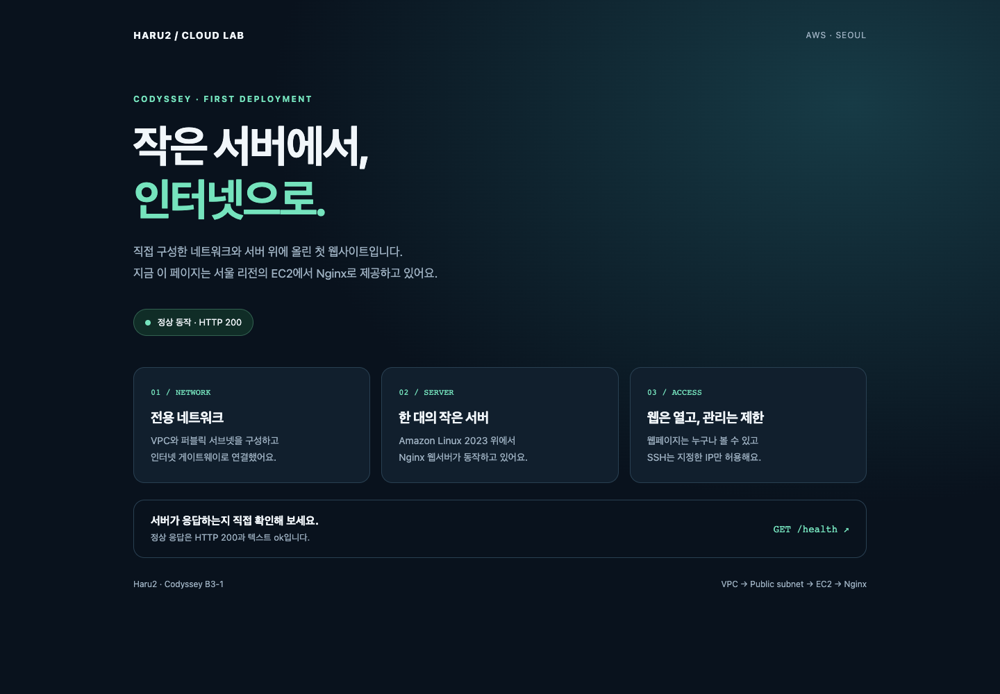
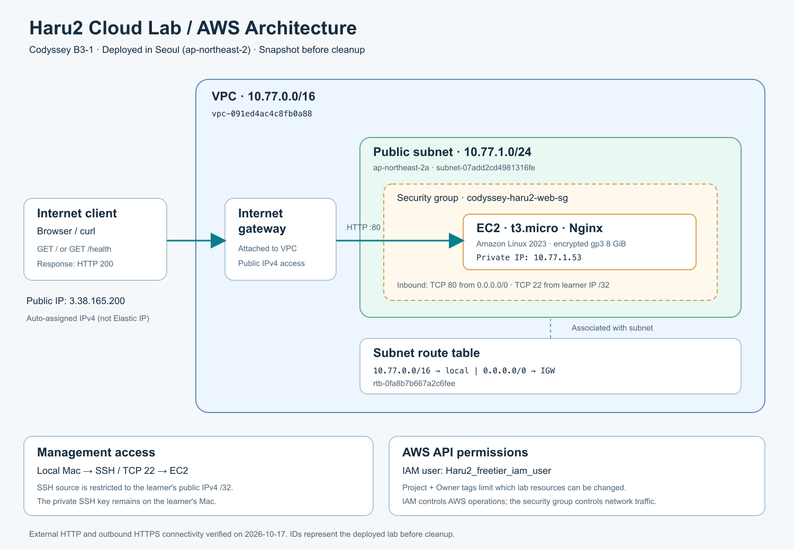

# Codyssey B3-1 — 웹사이트를 AWS에 배포하기

서울 리전에 VPC, 퍼블릭 서브넷, 인터넷 게이트웨이, EC2 한 대를 구성하고 Nginx로 정적 웹페이지와 `/health`를 제공했다.

**현재 상태: 필수 구성·배포·외부 접속 검증·증빙 저장·AWS 실습 자원 정리 완료. 정리 완료 시각: 2026-10-17 17:36:10 KST. 웹사이트는 종료되어 접속되지 않는다.**

## 외부 접속 증빙

- 제출 방식: **B — GET /health**. 방식 A의 웹페이지 접속 화면도 함께 제출한다.
- 검증 시각: 2026-10-17 17:29:51 KST
- 검증 당시 웹페이지: `http://3.38.165.200/`
- 검증 당시 상태 확인: `http://3.38.165.200/health`
- 외부 Mac의 브라우저에서 홈페이지 **HTTP 200**, `/health` **HTTP 200**, 본문 **`ok\n`** 확인.
- 서버 내부의 `http://localhost/`도 HTTP 200이며, 외부 `https://example.com`으로의 HTTPS 요청도 HTTP 200이었다.
- 위 공인 IP는 자동 할당 IP다. 인스턴스 종료 후에는 유효한 실습 접속 주소가 아니므로 재사용하지 않는다.



[외부 HTTP 응답 원본](docs/evidence/external-http-check.json) · [서버 내부/외부 연결 확인](docs/evidence/ssh-and-outbound-check.txt) · [배포 로그](docs/evidence/deployment-log.txt)

## 제출 파일

| 요구사항 | 파일 |
|---|---|
| 구성도 1장 | [docs/architecture.png](docs/architecture.png) |
| 외부 접속 정보와 스크린샷 | 이 README 및 [접속 화면](docs/evidence/external-homepage.png) |
| 실제 문제의 증상·가설·검증·조치·결과·재발 방지 | [docs/troubleshooting.md](docs/troubleshooting.md) |
| 자원 정리 체크리스트 | [docs/cleanup-checklist.md](docs/cleanup-checklist.md) |

## 구축한 구성



| 항목 | 설정 / 식별자 |
|---|---|
| 리전 / 가용 영역 | `ap-northeast-2` / `ap-northeast-2a` |
| VPC | `codyssey-haru2-vpc`, `vpc-091ed4ac4c8fb0a88`, `10.77.0.0/16` |
| 퍼블릭 서브넷 | `subnet-07add2cd4981316fe`, `10.77.1.0/24` |
| 인터넷 게이트웨이 | `igw-0e0032f28ada231c5` |
| 라우팅 테이블 | `rtb-0fa8b7b667a2c6fee` |
| 기본 경로 | `0.0.0.0/0 → igw-0e0032f28ada231c5` |
| EC2 | `codyssey-haru2-web`, `i-0662f24aee4fe0031`, `t3.micro` |
| OS / AMI | Amazon Linux 2023 / `ami-0e058fd137468076a` |
| 내부 IP / 검증 당시 공인 IP | `10.77.1.53` / `3.38.165.200` |
| 디스크 | 암호화된 gp3 8 GiB, 3000 IOPS / 125 MiB/s, 종료 시 자동 삭제 |
| CPU 크레딧 | Standard |
| 보안 그룹 | `sg-09c2e52786f6da9a7` |
| HTTP | TCP 80, `0.0.0.0/0` |
| SSH | TCP 22, 생성 시 확인한 학습자 공인 IP의 `/32`만 허용 |
| SSH 키페어 | `codyssey-haru2-key`, ED25519 공개키 등록 |
| IAM 사용자 | `Haru2_freetier_iam_user` |

NAT Gateway, 로드밸런서, RDS, Elastic IP는 만들지 않았다. VPC 생성 시 AWS가 기본 라우팅 테이블·보안 그룹·네트워크 ACL을 자동 생성하지만, 실습용 EC2에는 별도 보안 그룹과 명시적으로 연결한 라우팅 테이블을 사용했다.

## 요청이 도착하는 과정

1. 브라우저가 EC2의 공인 IP로 TCP 80 요청을 보낸다.
2. VPC에 연결된 인터넷 게이트웨이를 통해 EC2의 네트워크 인터페이스로 전달된다.
3. 보안 그룹의 TCP 80 허용 규칙을 통과하면 Nginx가 홈페이지 또는 `/health` 응답을 반환한다.
4. 서브넷의 라우팅 테이블은 외부 목적지 `0.0.0.0/0`를 인터넷 게이트웨이로 보낸다. 따라서 응답과 서버의 외부 HTTPS 접속이 가능하다.
5. SSH는 동일한 공인 IP의 TCP 22를 사용하지만, 현재 학습자의 IP만 허용한다.

IAM은 AWS API 작업을 허용한다. 보안 그룹은 네트워크 통신을 허용한다. IAM에서 EC2 조회 권한을 추가해도 HTTP 포트가 열리지는 않으며, 보안 그룹에서 HTTP를 열어도 IAM 권한이 생기지는 않는다.

## 최소 권한과 태그

`SignInLocalDevelopmentAccess`는 CLI 인증용으로 유지하고, [과제용 사용자 지정 정책](docs/CodysseyB3LabPolicy-Haru2.json)을 별도로 연결했다. 실습 작업에 AdministratorAccess는 사용하지 않았다.

생성하는 자원에는 다음 태그를 동시에 지정했다.

```text
Project = Codyssey-B3-1
Owner   = Haru2_freetier_iam_user
Name    = codyssey-haru2-<resource>
```

기존 자원의 변경·삭제는 Project와 Owner 태그가 모두 일치할 때만 허용했다. 생성 시에만 태그를 붙일 수 있어 다른 사람의 기존 자원을 본인 소유로 다시 표시하는 권한을 부여하지 않았다. 일부 조회 API는 자원별 제한을 지원하지 않으므로 같은 리전의 다른 자원 목록은 보일 수 있다.

[권한 검사 결과](docs/evidence/permissions-check.json): 조회 21종, 태그가 있는 생성 사전 검사 3종, 제한 동작 4종을 확인했다. 이후 실제 VPC·서브넷·라우팅·보안 그룹·키페어·EC2 생성에도 성공했다. 권한 사전 검사 성공은 AWS가 `DryRunOperation`으로 응답한다.

## 같은 구성을 다시 실습할 때

1. 서울 리전을 선택하고 새 SSH 키를 로컬에 만든다. 개인키는 저장소에 넣지 않는다.
2. 위 태그와 함께 VPC → 서브넷 → 인터넷 게이트웨이 → 라우팅 테이블을 생성한다.
3. 인터넷 게이트웨이를 VPC에 연결하고 `0.0.0.0/0` 경로를 추가한 뒤, 라우팅 테이블을 서브넷에 연결한다.
4. 현재 공인 IP를 다시 확인해 SSH `/32` 규칙을 만들고 HTTP 80을 허용한다.
5. 공개키를 등록하고, 최신 Amazon Linux 2023 이미지와 본인 자원 ID를 사용해 EC2를 실행한다. 인스턴스·볼륨·네트워크 인터페이스 모두 생성 시 태그가 필요하다.
6. [실제 실행 요청](docs/evidence/launch-request.json)은 설정 참고용이다. 정리된 자원 ID와 ClientToken을 그대로 재사용하지 않는다.
7. SSH로 접속해 `sudo dnf install -y nginx`를 실행한다.
8. `site/index.html`을 `/usr/share/nginx/html/index.html`로, `config/nginx.conf`를 `/etc/nginx/nginx.conf`로 복사한다.
9. `sudo nginx -t`, `sudo systemctl enable --now nginx`, `sudo systemctl reload nginx`를 실행한다.
10. 아래 검사 후 증빙을 저장하고 자원을 정리한다.

```sh
# EC2 내부
curl -i http://localhost/
curl -i http://localhost/health
curl -I https://example.com

# 외부 Mac — 실제 새 공인 IP로 바꾼다.
curl -i http://PUBLIC_IP/health
```

## 비용과 정리

프리티어는 IAM 사용자별로 추가되는 혜택이 아니다. 계정 전체의 적용 조건과 잔여량에 따라 달라진다. 이 정책은 리전·인스턴스 종류·볼륨 크기를 제한하지만 생성 개수나 총요금을 제한하는 장치는 아니다. 이번 실습은 EC2 한 대와 디스크 한 개로 진행했으며, 증빙 저장 후 두 자원을 모두 정리했다.

정리 상태와 API 확인 결과는 [정리 체크리스트](docs/cleanup-checklist.md)에 기록했다. Billing 화면은 이번 IAM 권한에 포함되지 않아 조회하지 않았다.
