# AWS 콘솔 화면으로 따라하는 웹서버 만들기

2026년 10월 17일 실제 재구축 · 10월 19일 초보자 스터디

[브라우저로 넘겨보기](index.html) · [45분 스터디 노트](../study-notes.md) · [온라인 따라하기](https://chatgpt.com/space/page_7d4e669d7c288191a35b2103480deed2)

VPC부터 웹페이지 접속까지 실제 화면에 말풍선을 붙였다. 아래 순서대로 따라가되, 계정마다 달라지는 자원 ID와 현재 내 공인 IP는 본인 값으로 바꾼다.

**현재 접속:** [웹페이지](http://43.201.62.16/) · [상태 확인](http://43.201.62.16/health). 사용자 선택에 따라 19일까지 실행 상태로 유지한다. 자동 종료는 설정하지 않았다.

태그는 모든 생성 화면에서 `Project=Codyssey-B3-1`, `Owner=Haru2_freetier_iam_user`를 사용했다. 본인 IAM 정책을 사용하는 다른 계정은 정책의 값에 맞춰야 한다. 서브넷의 public이라는 이름만으로 인터넷 연결이 되는 것은 아니다.

일부 캡처에 보이는 Carrier Gateway·NAT Gateway·GetSecurityGroupsForVpc·Compute Optimizer 조회 오류는 해당 보조 기능의 권한이 없어서 발생했다. 이번 구성의 생성·연결·접속은 별도로 성공을 확인했다. 새로운 권한 오류가 보이면 오류의 작업 이름과 실패한 실제 동작을 구분한다.


## VPC와 서브넷

### 01 VPC 메뉴에서 시작하기

서울 리전에서 VPC 서비스로 이동하고 VPC 생성을 누른다.

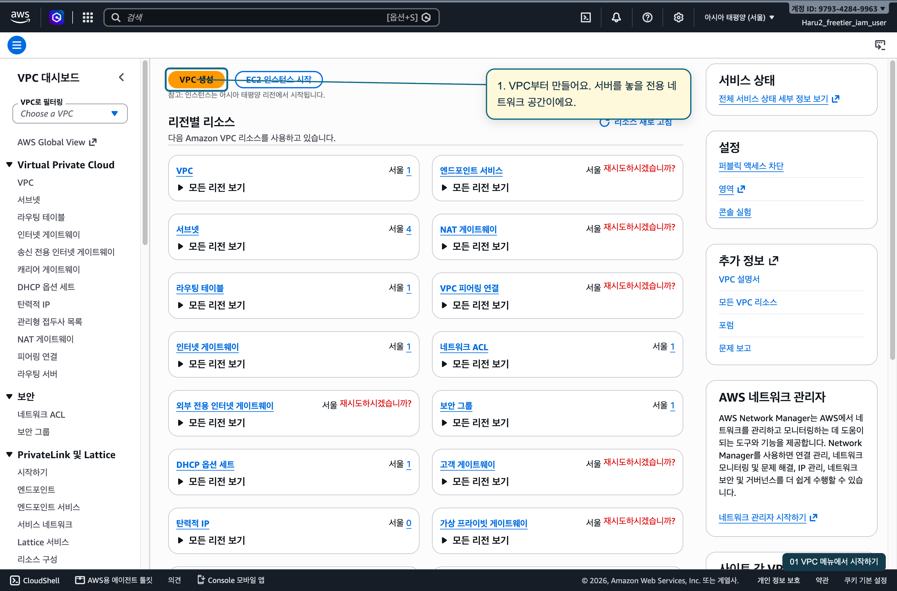

VPC부터 만들어요. 서버를 놓을 전용 네트워크 공간이에요.

[말풍선 없는 원본](raw/03-vpc-start.png)

### 02 VPC만 선택하기

생성할 리소스에서 VPC만을 선택한다. 나머지는 다음 단계에서 직접 연결한다.

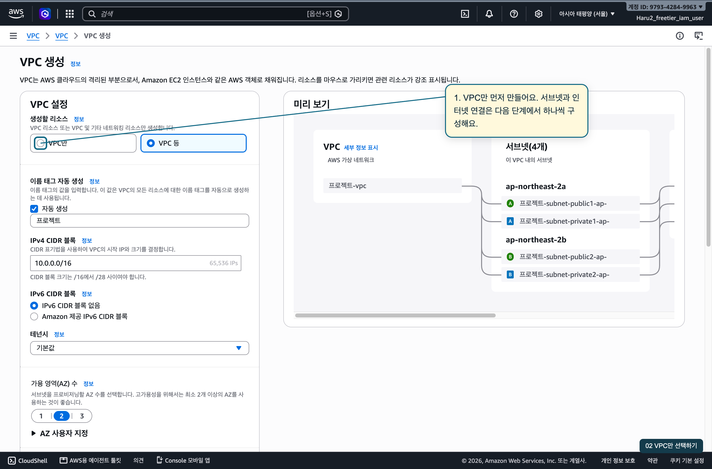

VPC만 먼저 만들어요. 서브넷과 인터넷 연결은 다음 단계에서 하나씩 구성해요.

[말풍선 없는 원본](raw/04-vpc-create-choice.png)

### 03 VPC 이름과 주소 범위

이름 codyssey-haru2-study-vpc, IPv4 CIDR 10.77.0.0/16을 입력한다. IPv6 없음과 기본 테넌시를 유지한다.


다른 사람의 자원과 구분할 수 있도록 실습 이름을 붙여요. 10.77.0.0/16은 VPC 내부에서 사용할 큰 주소 범위예요.

[말풍선 없는 원본](raw/05-vpc-name-cidr.png)

### 04 소유 태그와 생성 직전 확인

Project=Codyssey-B3-1, Owner=Haru2_freetier_iam_user를 추가하고 VPC 생성을 누른다. 이 값은 이번 IAM 정책의 생성 조건이다.

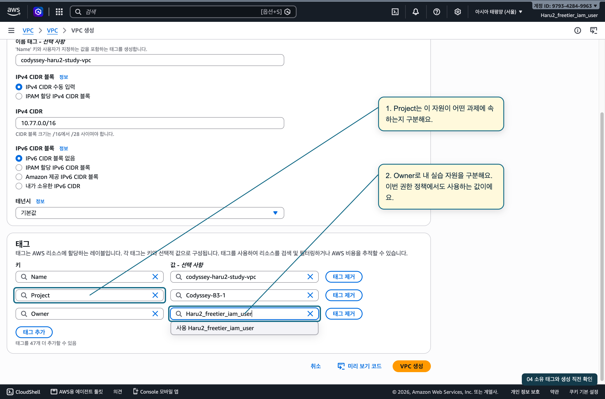

Project는 이 자원이 어떤 과제에 속하는지 구분해요. Owner로 내 실습 자원을 구분해요. 이번 권한 정책에서도 사용하는 값이에요.

[말풍선 없는 원본](raw/06-vpc-tags-before-create.png)

### 05 VPC 생성 결과 확인

VPC 상태 Available과 IPv4 CIDR을 확인한다. 이 단계만으로 인터넷에 연결되는 것은 아니다.

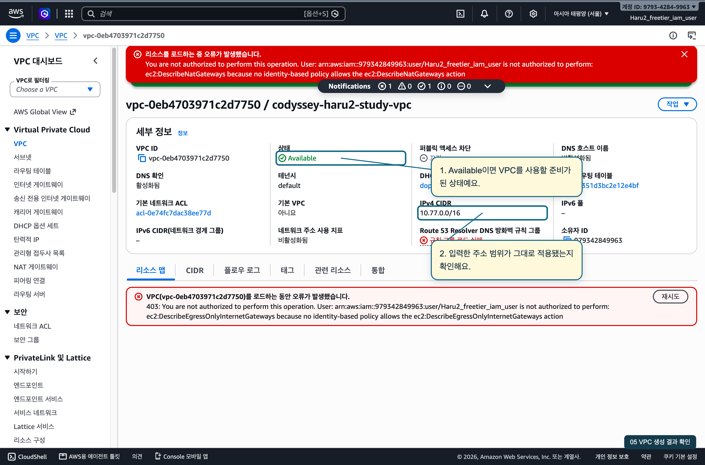

Available이면 VPC를 사용할 준비가 된 상태예요. 입력한 주소 범위가 그대로 적용됐는지 확인해요.

[말풍선 없는 원본](raw/07b-vpc-created.png)

### 06 서브넷 만들기 시작

왼쪽 서브넷 메뉴에서 서브넷 생성을 누른다.

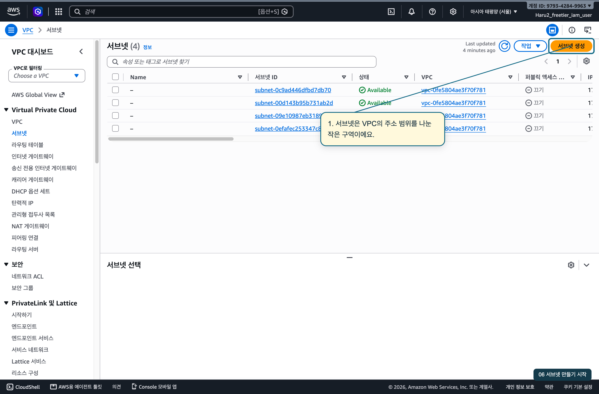

서브넷은 VPC의 주소 범위를 나눈 작은 구역이에요.

[말풍선 없는 원본](raw/08-subnet-list.png)

### 07 이번 VPC를 선택

기본 VPC 대신 방금 만든 codyssey-haru2-study-vpc를 선택한다.

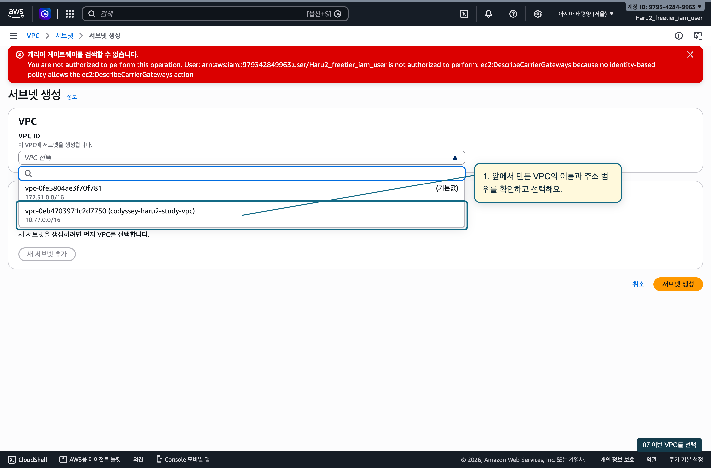

앞에서 만든 VPC의 이름과 주소 범위를 확인하고 선택해요.

[말풍선 없는 원본](raw/09c-subnet-vpc-choice.png)

### 08 서브넷 위치와 주소 범위

서브넷 이름 codyssey-haru2-study-public, 가용 영역 ap-northeast-2a, CIDR 10.77.1.0/24를 입력한다.


서브넷은 하나의 가용 영역에 속해요. 이번에는 서울의 2a를 골라요. 10.77.1.0/24는 VPC 주소 범위 안에 있는 작은 구역이에요.

[말풍선 없는 원본](raw/11-subnet-settings.png)

### 09 서브넷 태그와 생성

VPC와 같은 Project와 Owner 태그를 넣고 서브넷 생성을 누른다.

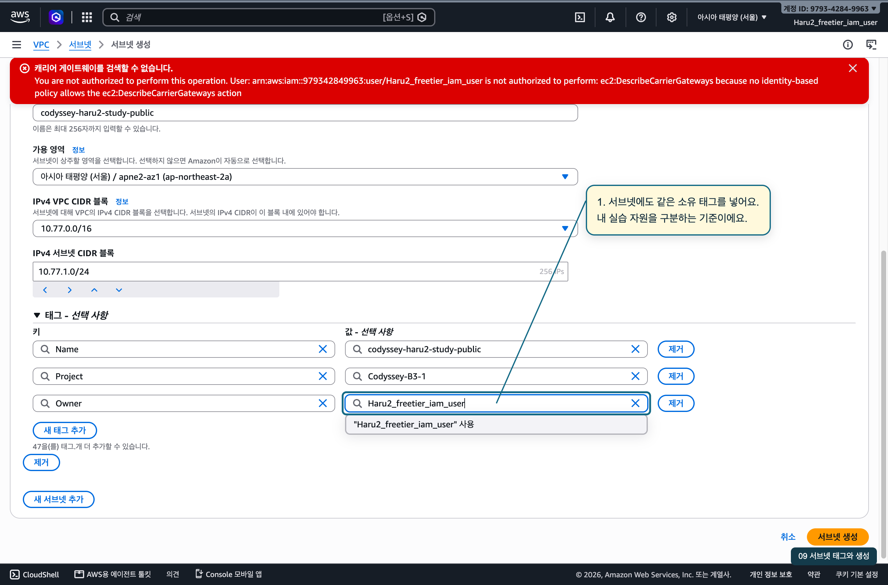

서브넷에도 같은 소유 태그를 넣어요. 내 실습 자원을 구분하는 기준이에요.

[말풍선 없는 원본](raw/12-subnet-tags-create.png)

### 10 서브넷 주소 범위 재확인

생성된 서브넷 주소를 확인한다. 이 확인 화면은 EC2 생성 후 다시 촬영했다.

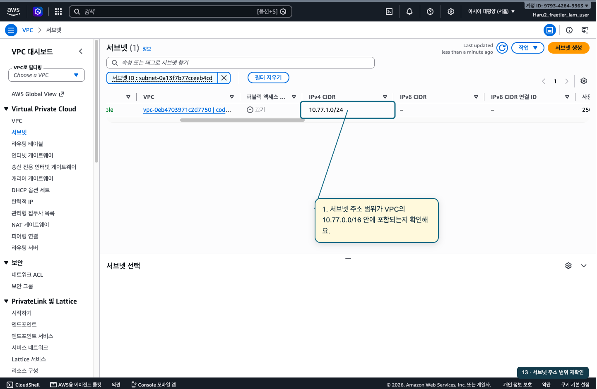

서브넷 주소 범위가 VPC의 10.77.0.0/16 안에 포함되는지 확인해요.

[말풍선 없는 원본](raw/13c-subnet-confirmed.png)

## 인터넷 경로 연결

### 11 인터넷 게이트웨이 만들기

인터넷 게이트웨이 메뉴에서 인터넷 게이트웨이 생성을 누른다.

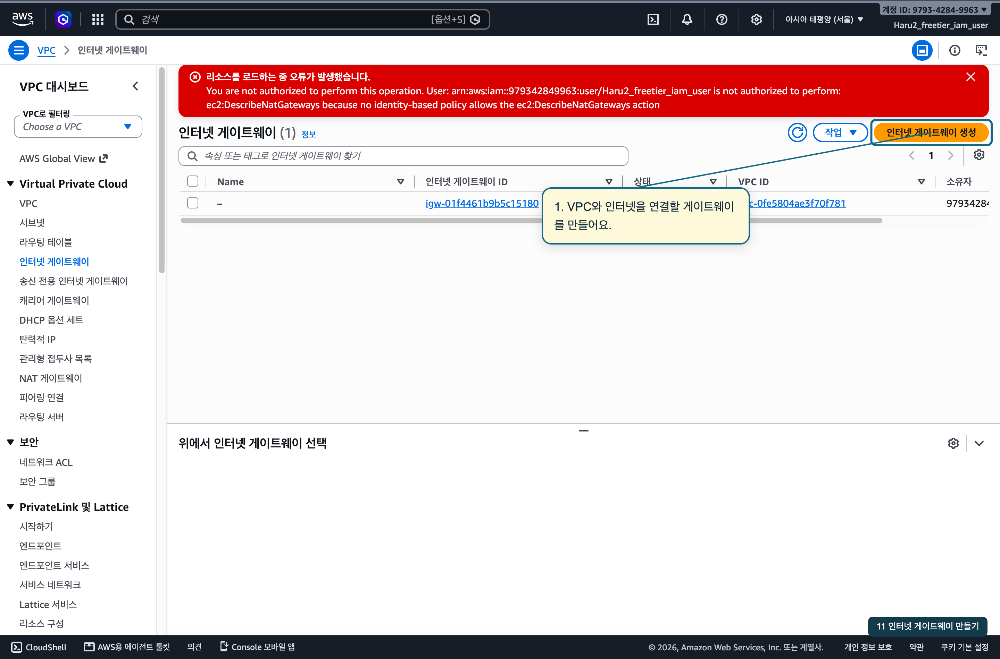

VPC와 인터넷을 연결할 게이트웨이를 만들어요.

[말풍선 없는 원본](raw/14-igw-list.png)

### 12 인터넷 게이트웨이 입력

이름 codyssey-haru2-study-igw와 같은 Project·Owner 태그를 넣고 생성한다.

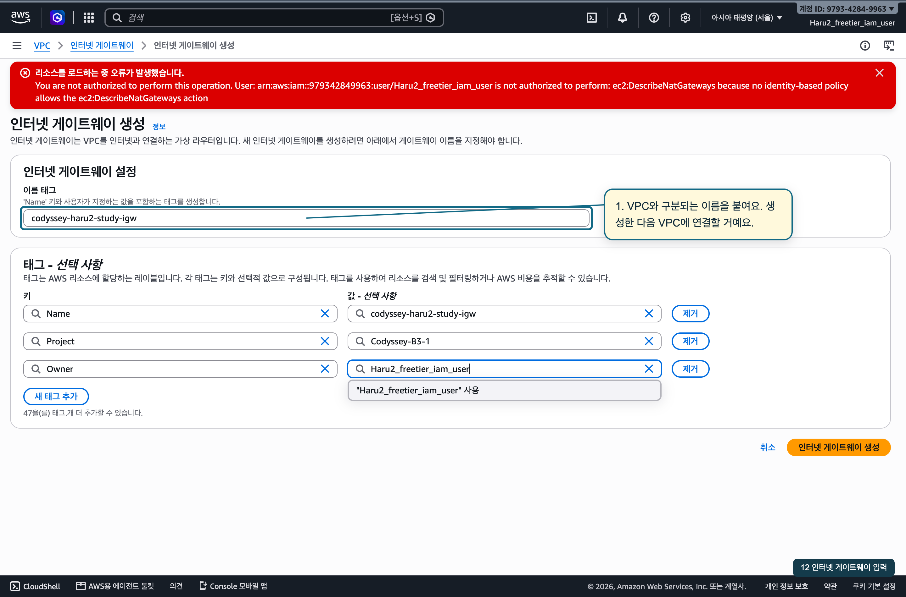

VPC와 구분되는 이름을 붙여요. 생성한 다음 VPC에 연결할 거예요.

[말풍선 없는 원본](raw/15-igw-before-create.png)

### 13 아직 VPC에 연결하지 않은 상태

처음에는 Detached로 표시된다. 게이트웨이를 만든 뒤 VPC에 붙이는 작업이 따로 필요하다.

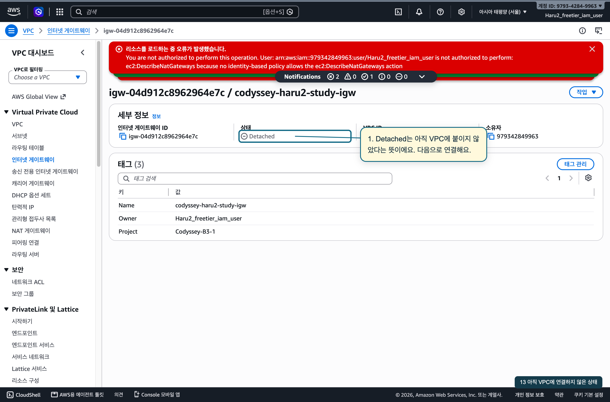

Detached는 아직 VPC에 붙이지 않았다는 뜻이에요. 다음으로 연결해요.

[말풍선 없는 원본](raw/16b-igw-detached.png)

### 14 작업 메뉴에서 VPC 연결

이번 게이트웨이를 선택하고 작업 → VPC에 연결을 누른다.

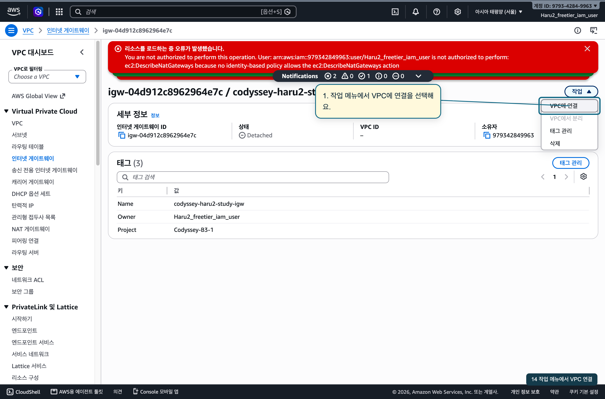

작업 메뉴에서 VPC에 연결을 선택해요.

[말풍선 없는 원본](raw/17b-igw-attach-menu.png)

### 15 연결할 VPC 확인

codyssey-haru2-study-vpc를 선택하고 인터넷 게이트웨이 연결을 누른다.

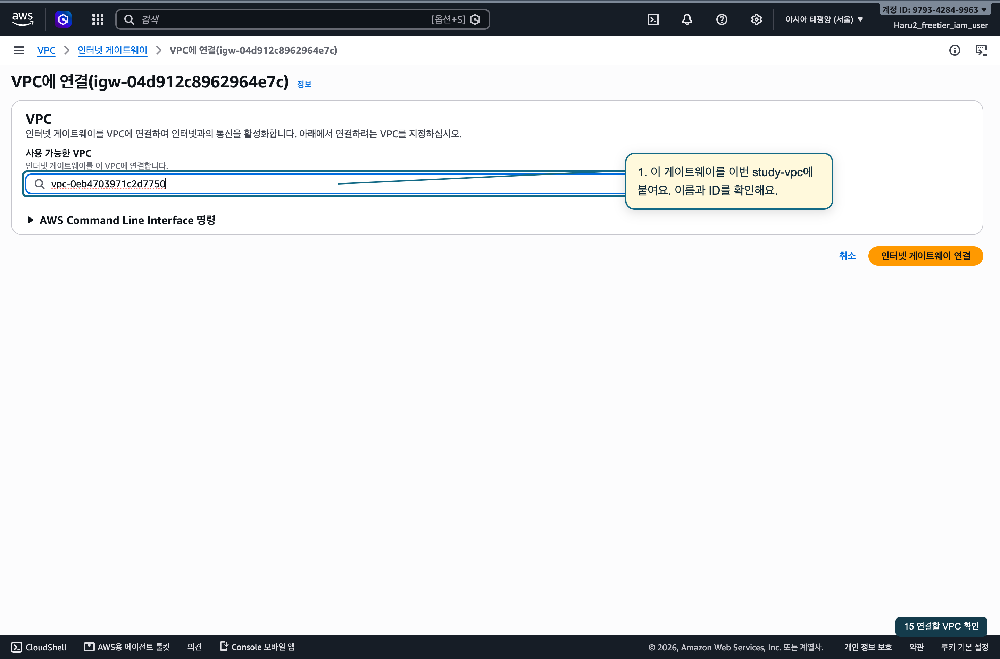

이 게이트웨이를 이번 study-vpc에 붙여요. 이름과 ID를 확인해요.

[말풍선 없는 원본](raw/19-igw-attach-confirm.png)

### 16 VPC 연결 완료

상태가 Attached이고 연결된 VPC가 맞는지 확인한다.

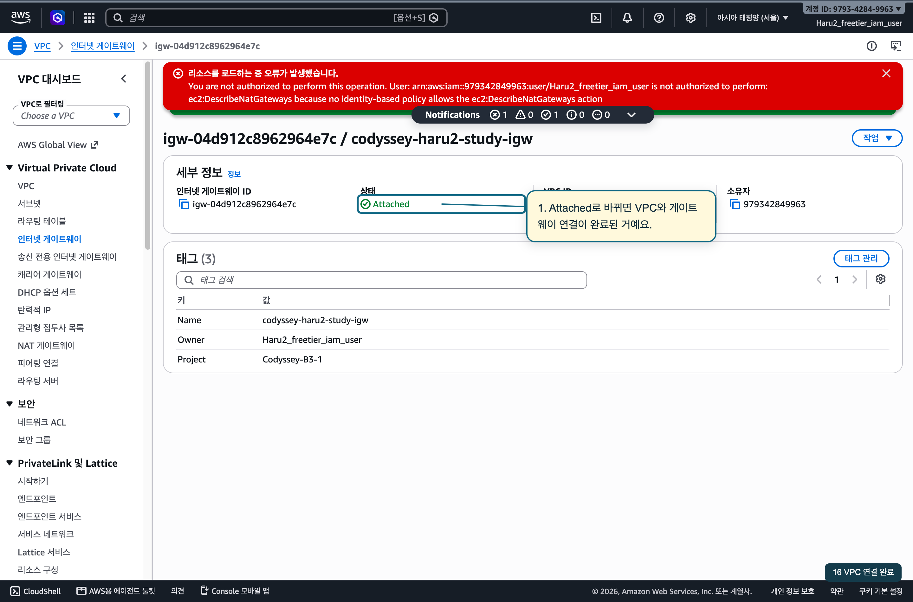

Attached로 바뀌면 VPC와 게이트웨이 연결이 완료된 거예요.

[말풍선 없는 원본](raw/20-igw-attached.png)

### 17 라우팅 테이블 만들기

라우팅 테이블 메뉴에서 라우팅 테이블 생성을 누른다.

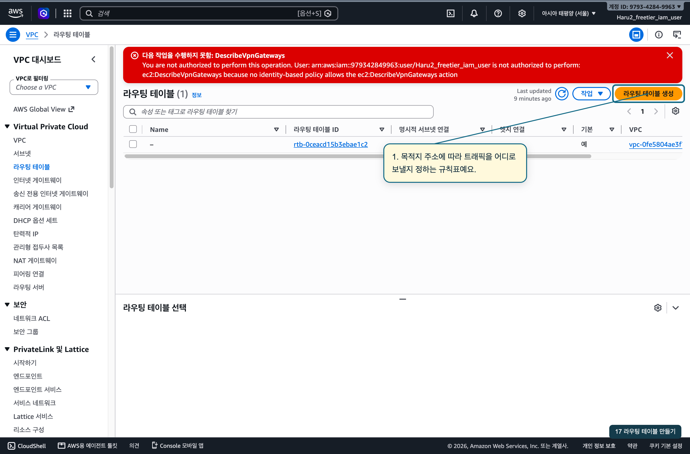

목적지 주소에 따라 트래픽을 어디로 보낼지 정하는 규칙표예요.

[말풍선 없는 원본](raw/21-route-table-list.png)

### 18 라우팅 테이블의 VPC 선택

라우팅 테이블이 속할 VPC로 codyssey-haru2-study-vpc를 선택한다.

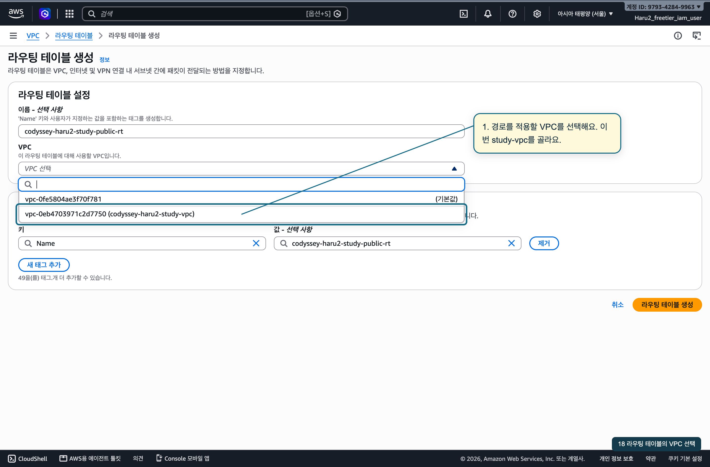

경로를 적용할 VPC를 선택해요. 이번 study-vpc를 골라요.

[말풍선 없는 원본](raw/22-route-vpc-choice.png)

### 19 라우팅 테이블 생성

이름 codyssey-haru2-study-public-rt와 같은 Project·Owner 태그를 넣고 생성한다.

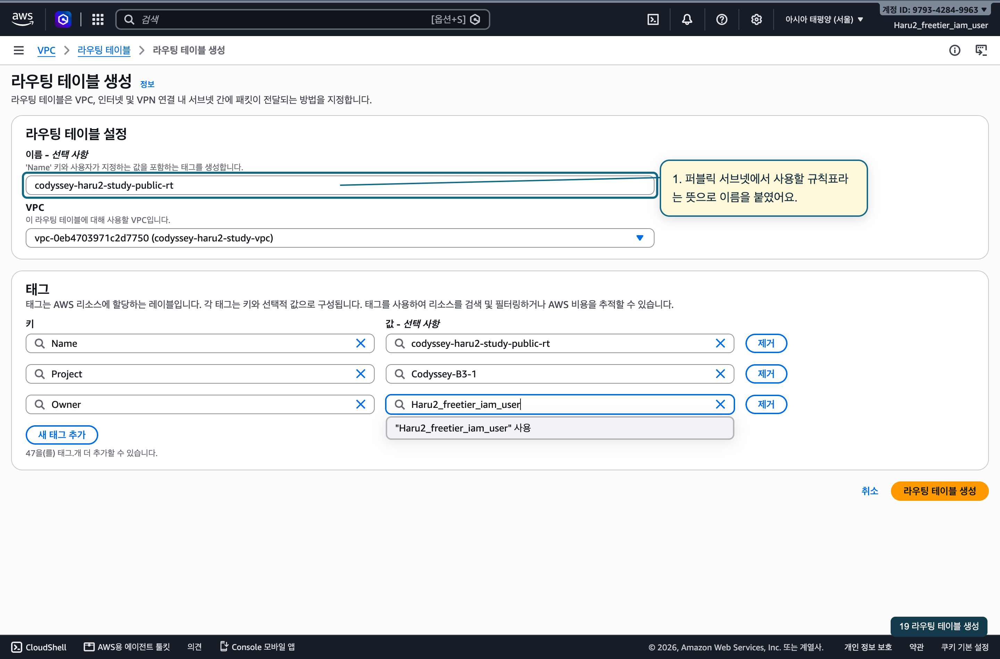

퍼블릭 서브넷에서 사용할 규칙표라는 뜻으로 이름을 붙였어요.

[말풍선 없는 원본](raw/23-route-table-before-create.png)

### 20 처음에는 내부 경로만 존재

라우팅 탭을 연다. 처음에는 VPC 내부용 local 경로만 있다.

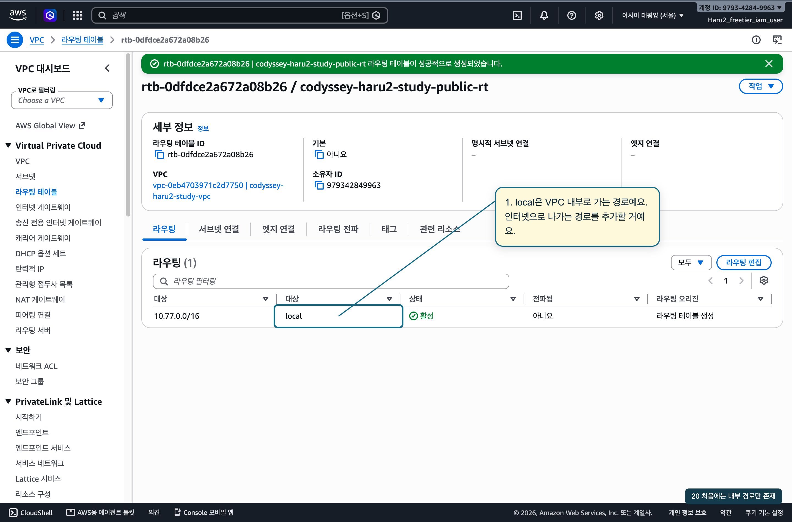

local은 VPC 내부로 가는 경로예요. 인터넷으로 나가는 경로를 추가할 거예요.

[말풍선 없는 원본](raw/24b-route-local-only.png)

### 21 기본 경로 추가 시작

라우팅 편집 → 라우팅 추가를 누른다.

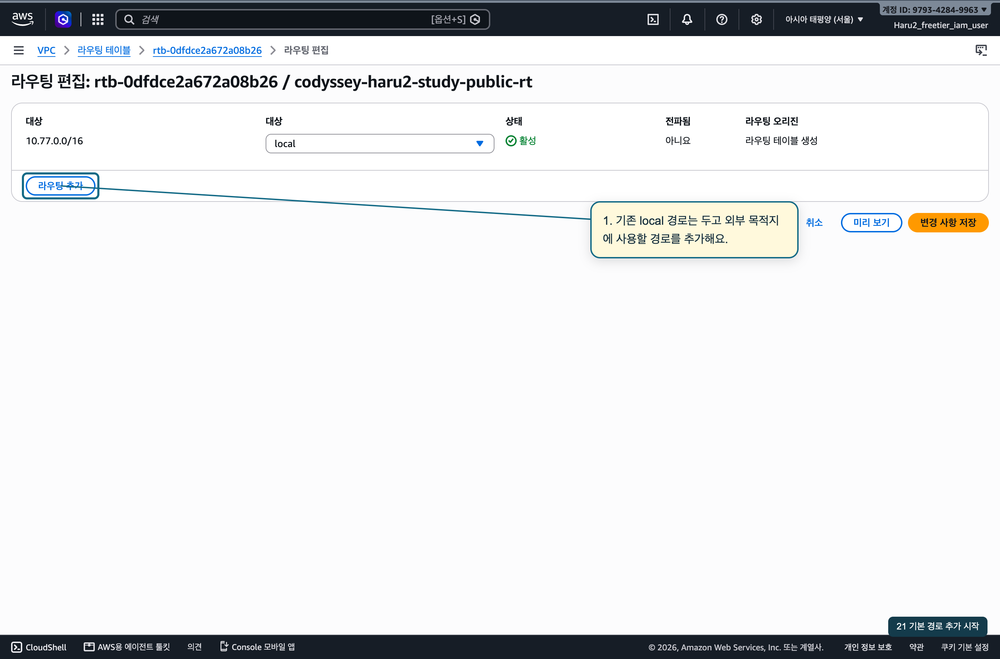

기존 local 경로는 두고 외부 목적지에 사용할 경로를 추가해요.

[말풍선 없는 원본](raw/25-route-add.png)

### 22 인터넷 연결 대상 선택

대상 유형으로 인터넷 게이트웨이를 고른다.

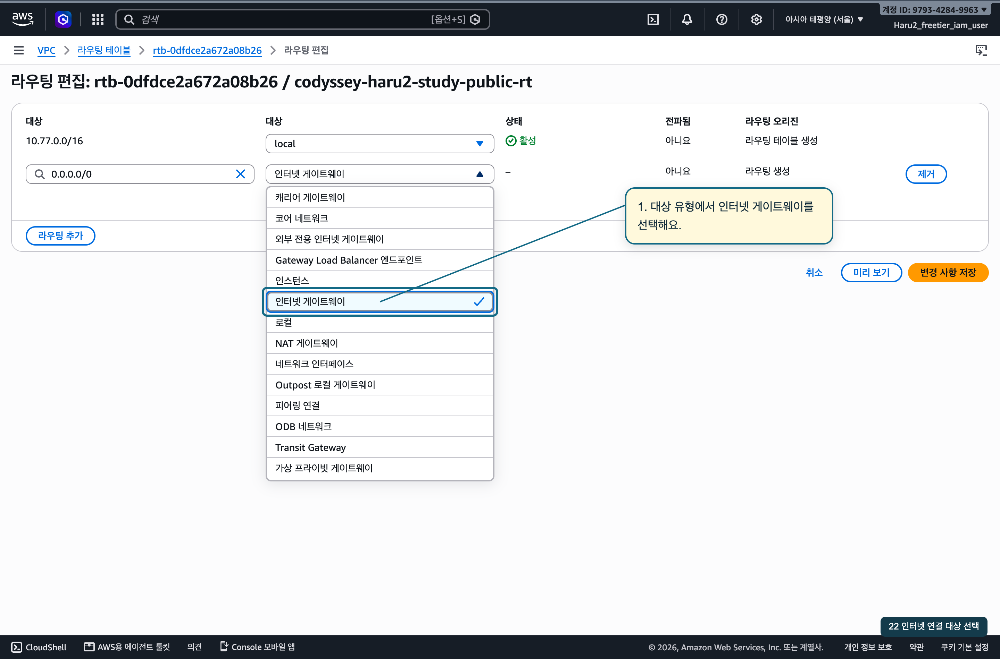

대상 유형에서 인터넷 게이트웨이를 선택해요.

[말풍선 없는 원본](raw/26b-route-target-type.png)

### 23 기본 경로 설정 확인

목적지 0.0.0.0/0, 대상은 이번 게이트웨이로 지정하고 저장한다. 이 화면은 저장한 설정을 다시 열어 확인한 모습이다.


0.0.0.0/0은 더 구체적인 경로가 없는 외부 IPv4 목적지에 쓰는 기본 경로예요. 방금 VPC에 연결한 인터넷 게이트웨이로 보내도록 설정했어요.

[말풍선 없는 원본](raw/28-route-settings.png)

### 24 경로를 서브넷에 적용하기

서브넷 연결 탭에서 서브넷 연결 편집을 누른다.

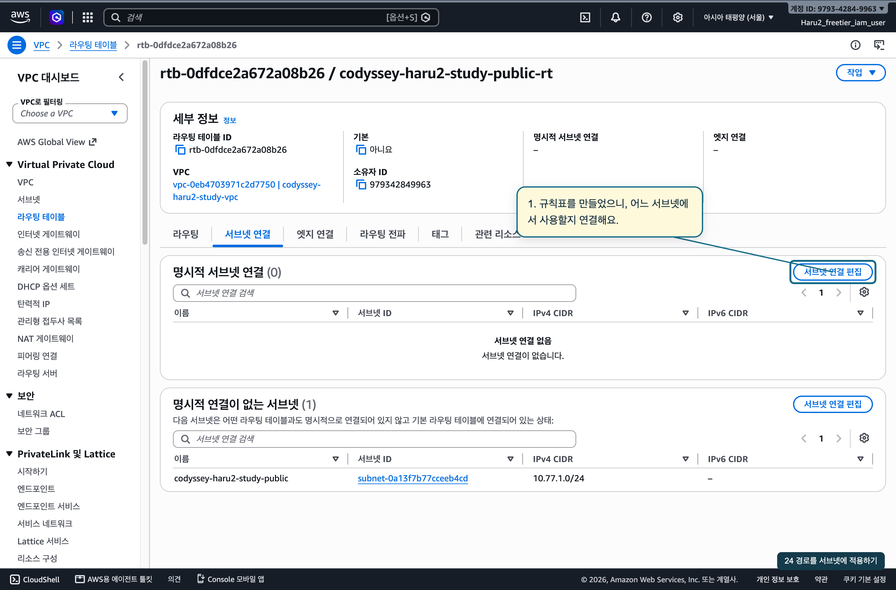

규칙표를 만들었으니, 어느 서브넷에서 사용할지 연결해요.

[말풍선 없는 원본](raw/30-route-subnet-tab.png)

### 25 실습 서브넷 선택 후 저장

codyssey-haru2-study-public을 선택하고 연결을 저장한다.

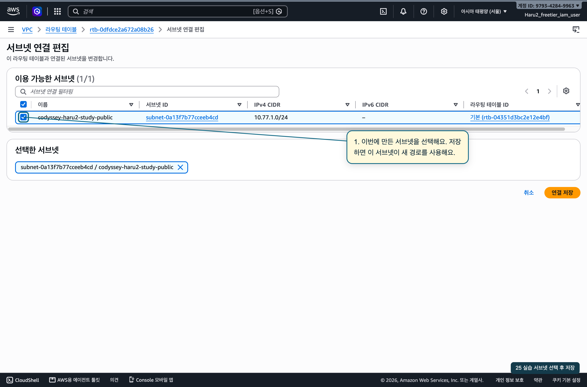

이번에 만든 서브넷을 선택해요. 저장하면 이 서브넷이 새 경로를 사용해요.

[말풍선 없는 원본](raw/31-route-subnet-selected.png)

### 26 서브넷 연결 완료

명시적 서브넷 연결에 이번 서브넷이 표시되는지 확인한다.


명시적 서브넷 연결에 표시되면, 이 서브넷에 경로가 적용된 거예요.

[말풍선 없는 원본](raw/32-route-subnet-associated.png)

## 보안 그룹

### 27 접속 규칙 만들기

보안 그룹 메뉴에서 보안 그룹 생성을 누른다.

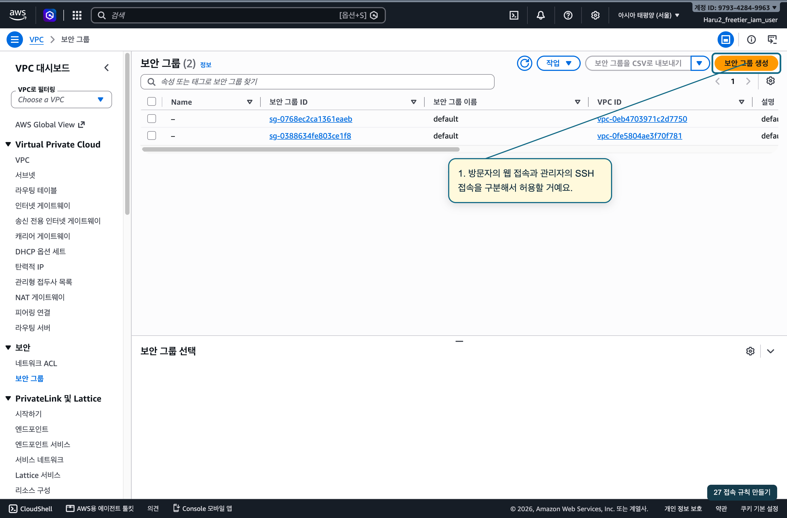

방문자의 웹 접속과 관리자의 SSH 접속을 구분해서 허용할 거예요.

[말풍선 없는 원본](raw/33b-security-group-start.png)

### 28 보안 그룹의 VPC 선택

이름 codyssey-haru2-study-web-sg, 설명 HTTP public; SSH from study host only를 입력하고 실습 VPC를 선택한다.

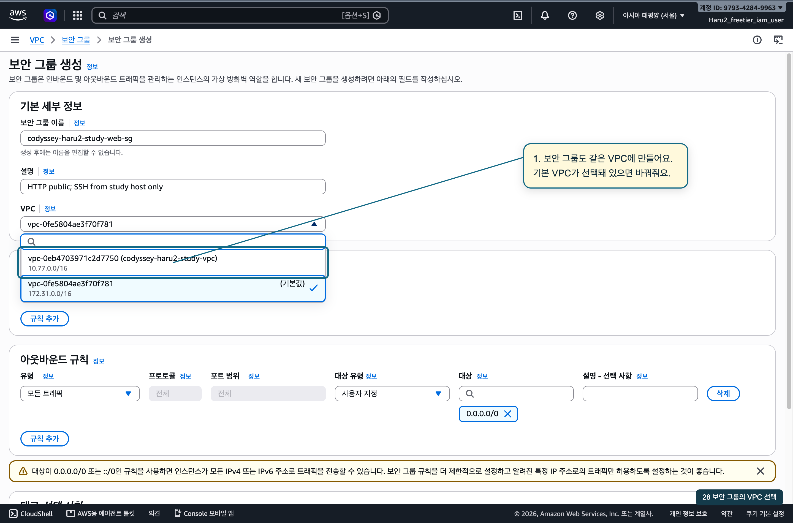

보안 그룹도 같은 VPC에 만들어요. 기본 VPC가 선택돼 있으면 바꿔줘요.

[말풍선 없는 원본](raw/34-sg-vpc-choice.png)

### 29 웹 접속과 관리 접속 구분

HTTP TCP 80은 0.0.0.0/0, SSH TCP 22는 현재 내 공인 IP/32를 입력한다. 화면의 IP를 그대로 복사하지 않는다.


80번은 웹페이지 방문용이에요. 모든 IPv4 주소에서 허용해요. 22번 관리 접속은 현재 내 주소 하나만 허용해요. /32는 주소 하나예요.

[말풍선 없는 원본](raw/38-sg-http-ssh.png)

### 30 보안 그룹 소유 태그

같은 Project·Owner 태그를 넣고 보안 그룹 생성을 누른다. 아웃바운드는 기본 전체 허용을 유지한다.

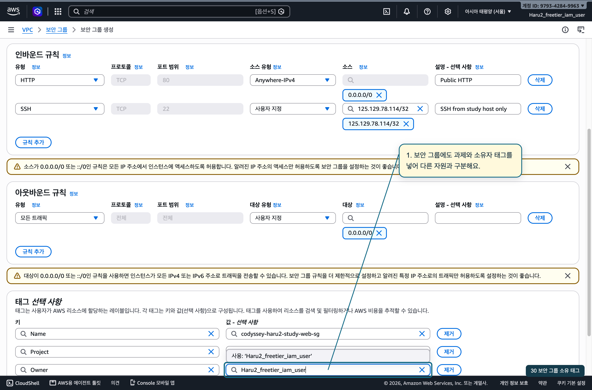

보안 그룹에도 과제와 소유자 태그를 넣어 다른 자원과 구분해요.

[말풍선 없는 원본](raw/39-sg-tags.png)

## 공개 키와 EC2

### 31 EC2 서비스로 이동

EC2 서비스로 이동한다.

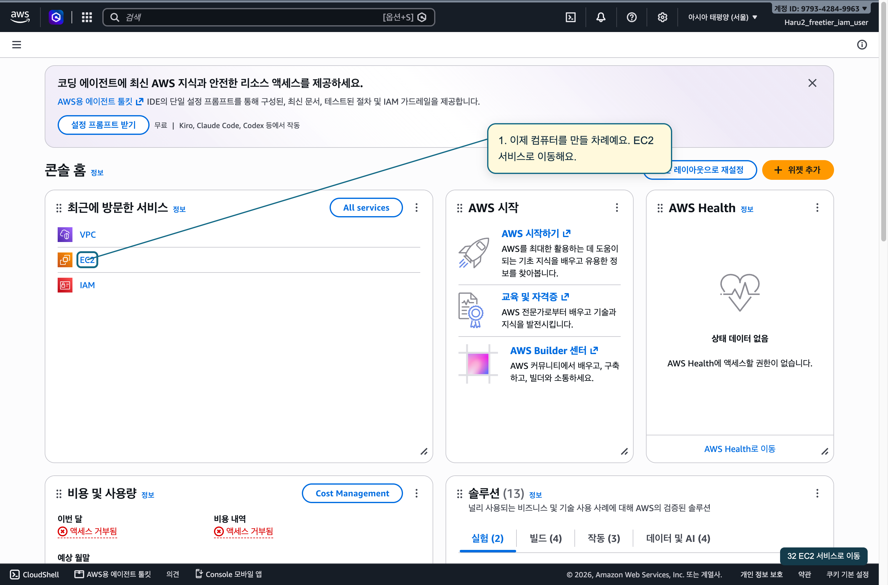

이제 컴퓨터를 만들 차례예요. EC2 서비스로 이동해요.

[말풍선 없는 원본](raw/41-console-ec2.png)

### 32 SSH 로그인 키 등록

왼쪽 네트워크 및 보안 → 키 페어를 연다.

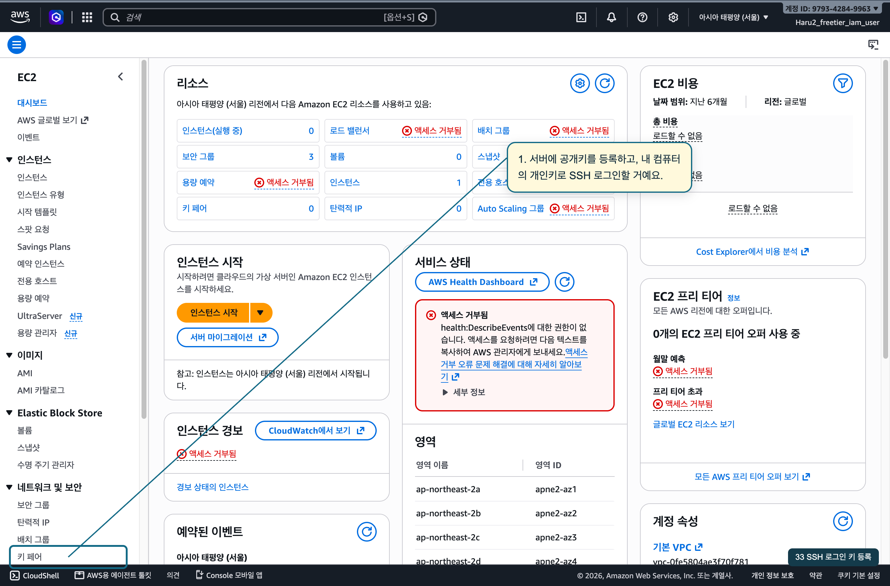

서버에 공개키를 등록하고, 내 컴퓨터의 개인키로 SSH 로그인할 거예요.

[말풍선 없는 원본](raw/42-ec2-key-pairs-menu.png)

### 33 SSH 로그인용 공개 키 가져오기

작업 → 키 페어 가져오기를 누른다. 이번 정책은 공개 키 가져오기를 허용한다.

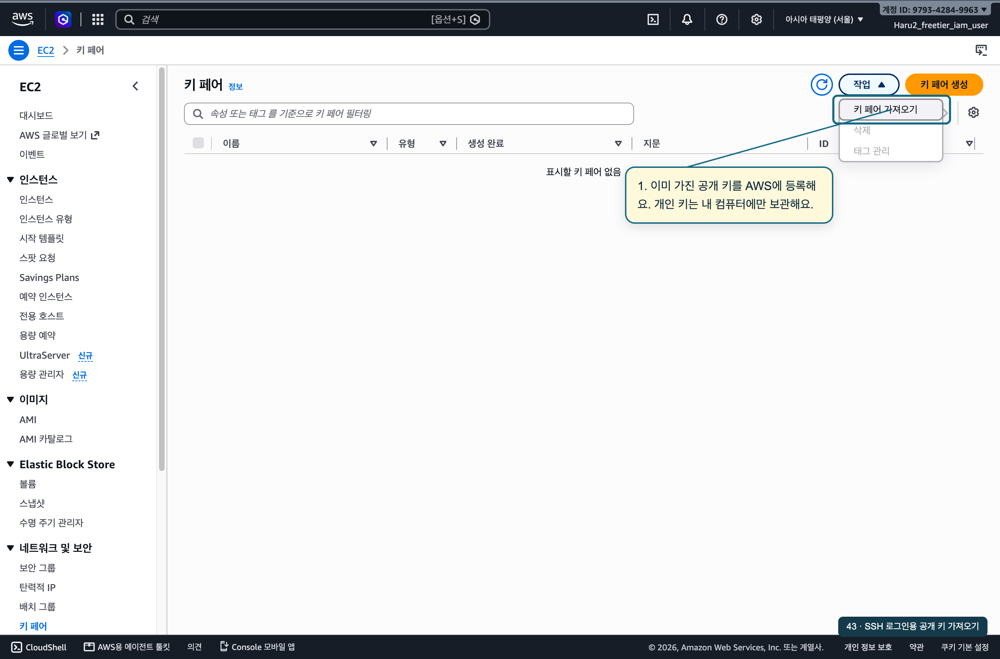

이미 가진 공개 키를 AWS에 등록해요. 개인 키는 내 컴퓨터에만 보관해요.

[말풍선 없는 원본](raw/43-key-import-menu.png)

### 34 SSH 공개 키 등록

이름 codyssey-haru2-study-key를 넣고 내 .pub 공개 키 내용을 붙인다. Project·Owner 태그를 넣고 가져온다. 개인 키 내용을 붙이지 않는다.

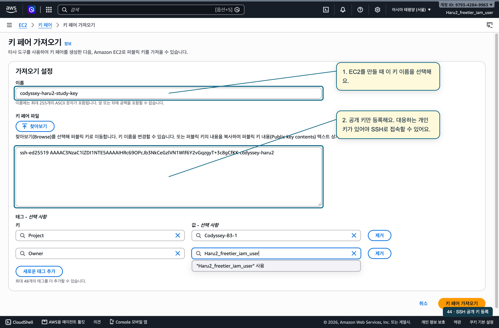

EC2를 만들 때 이 키 이름을 선택해요. 공개 키만 등록해요. 대응하는 개인 키가 있어야 SSH로 접속할 수 있어요.

[말풍선 없는 원본](raw/44-key-import-settings.png)

### 35 키 등록 완료

키 목록에 이름과 ed25519 유형이 표시되는지 확인한다.

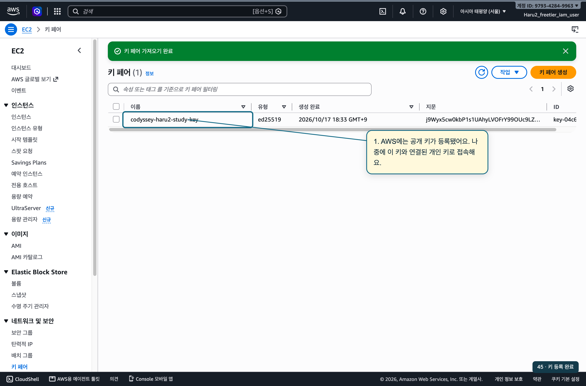

AWS에는 공개 키가 등록됐어요. 나중에 이 키와 연결된 개인 키로 접속해요.

[말풍선 없는 원본](raw/45b-key-imported.png)

### 36 EC2 서버 만들기 시작

인스턴스 메뉴에서 인스턴스 시작을 누른다.

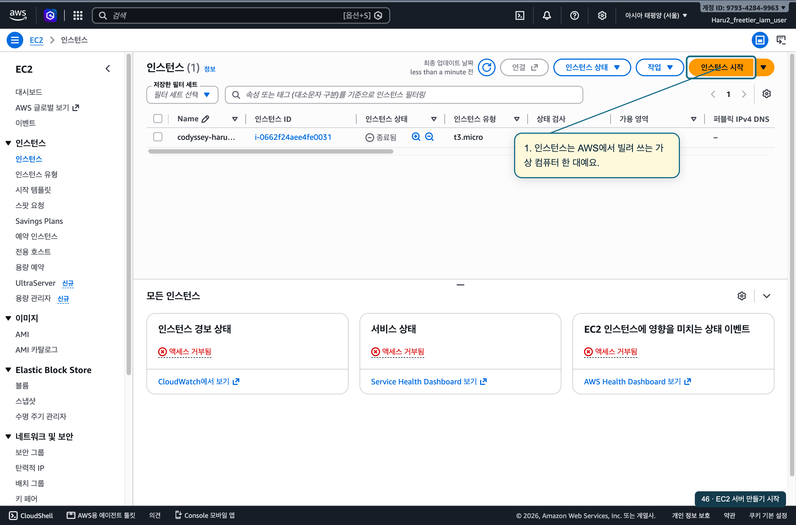

인스턴스는 AWS에서 빌려 쓰는 가상 컴퓨터 한 대예요.

[말풍선 없는 원본](raw/46-instance-list.png)

### 37 함께 생기는 자원에도 이름표 붙이기

Name=codyssey-haru2-study-web과 Project·Owner를 입력한다. 각 태그의 리소스 유형에서 인스턴스·볼륨·네트워크 인터페이스를 모두 선택한다.

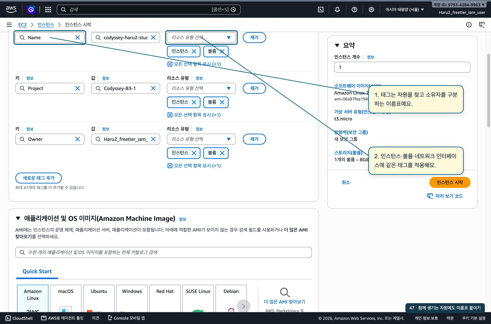

태그는 자원을 찾고 소유자를 구분하는 이름표예요. 인스턴스·볼륨·네트워크 인터페이스에 같은 태그를 적용해요.

[말풍선 없는 원본](raw/47b-instance-tags.png)

### 38 운영체제와 서버 크기

Amazon Linux 2023 x86_64와 t3.micro를 선택한다. AMI ID와 버전은 시점에 따라 바뀔 수 있다.


AMI는 운영체제 등이 준비된 설치 이미지예요. Amazon Linux를 사용해요. t3.micro는 서버의 크기예요. 이번 웹페이지 실습에 사용할 작은 서버예요.

[말풍선 없는 원본](raw/48-ami-choice.png)

### 39 로그인에 사용할 키 선택

앞서 가져온 codyssey-haru2-study-key를 선택한다.

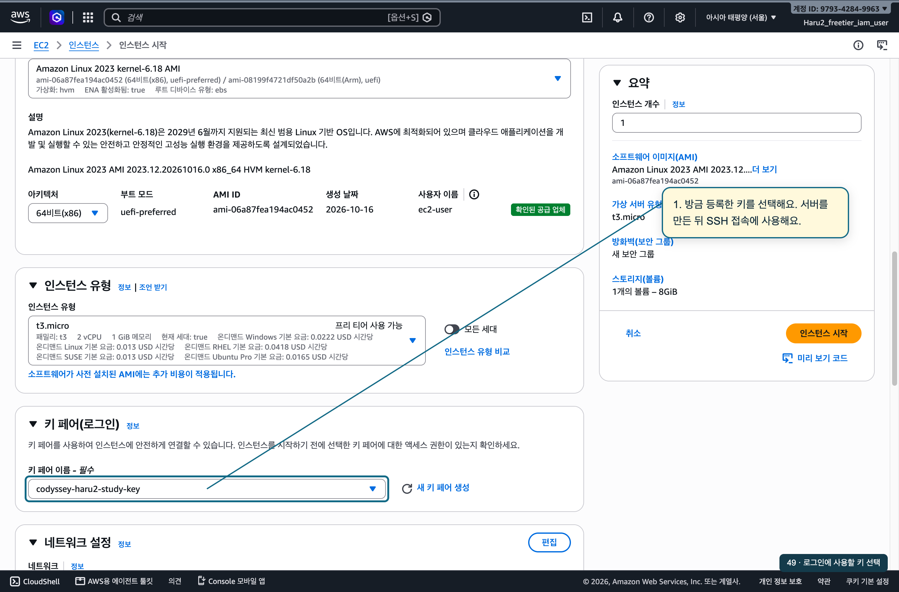

방금 등록한 키를 선택해요. 서버를 만든 뒤 SSH 접속에 사용해요.

[말풍선 없는 원본](raw/49-key-choice.png)

### 40 서버를 우리 네트워크에 배치

네트워크 편집에서 실습 VPC·서브넷을 선택하고 공개 IP를 활성화한다. 기존 보안 그룹 선택 → codyssey-haru2-study-web-sg를 지정한다.


VPC는 우리 실습용 네트워크 공간이에요. 서버가 들어갈 구역은 10.77.1.0/24 서브넷이에요. 공개 IP를 켜야 인터넷에서 이 서버의 주소로 접속할 수 있어요.

[말풍선 없는 원본](raw/51-instance-network.png)

### 41 서버의 디스크 EBS

스토리지는 gp3 8GiB, 3000 IOPS, 125MiB/s로 둔다. 고급에서 암호화됨과 종료 시 삭제 예를 확인한다.

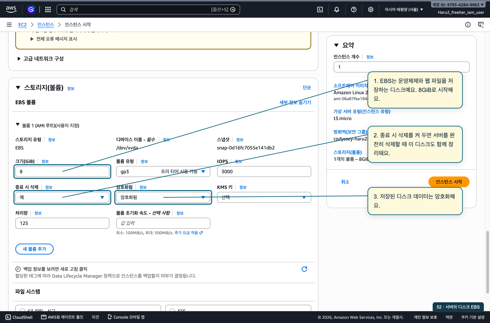

EBS는 운영체제와 웹 파일을 저장하는 디스크예요. 8GiB로 시작해요. 종료 시 삭제를 켜 두면 서버를 완전히 삭제할 때 이 디스크도 함께 정리돼요. 저장된 디스크 데이터는 암호화해요.

[말풍선 없는 원본](raw/52-ebs-disk.png)

### 42 CPU 크레딧 표준 모드

고급 세부 정보에서 크레딧 사양을 표준으로 선택한다. 메타데이터 버전은 V2만 해당을 유지한다.

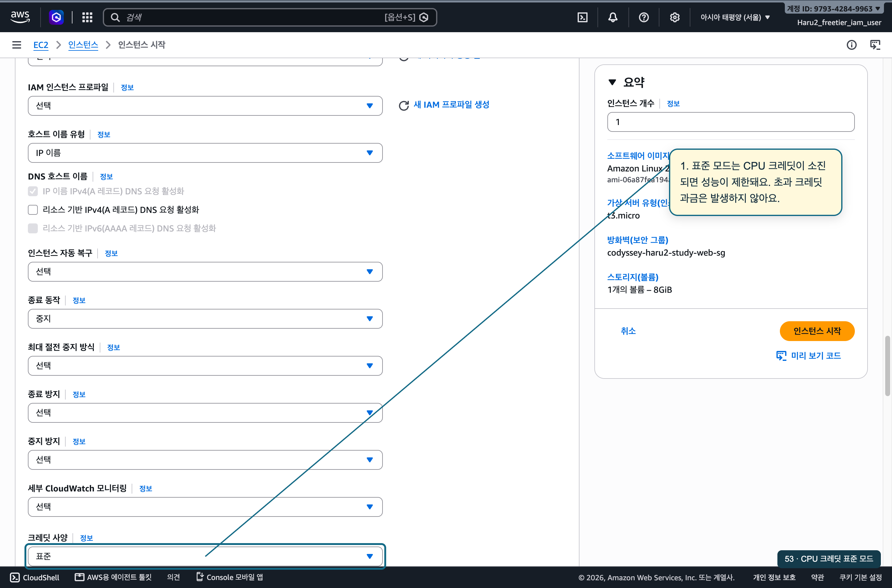

표준 모드는 CPU 크레딧이 소진되면 성능이 제한돼요. 초과 크레딧 과금은 발생하지 않아요.

[말풍선 없는 원본](raw/53-credit-standard.png)

### 43 설정 확인 후 서버 시작

인스턴스 개수 1, AMI·t3.micro·보안 그룹·디스크 요약을 확인한 뒤 인스턴스 시작을 누른다.

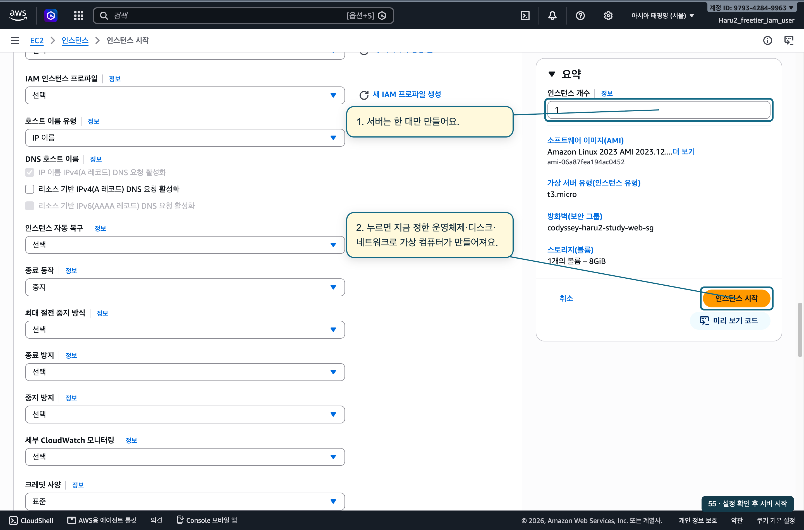

서버는 한 대만 만들어요. 누르면 지금 정한 운영체제·디스크·네트워크로 가상 컴퓨터가 만들어져요.

[말풍선 없는 원본](raw/55-launch-confirm.png)

### 44 서버 생성 성공

성공 메시지를 확인하고 생성된 인스턴스 ID를 눌러 상세 화면을 연다.

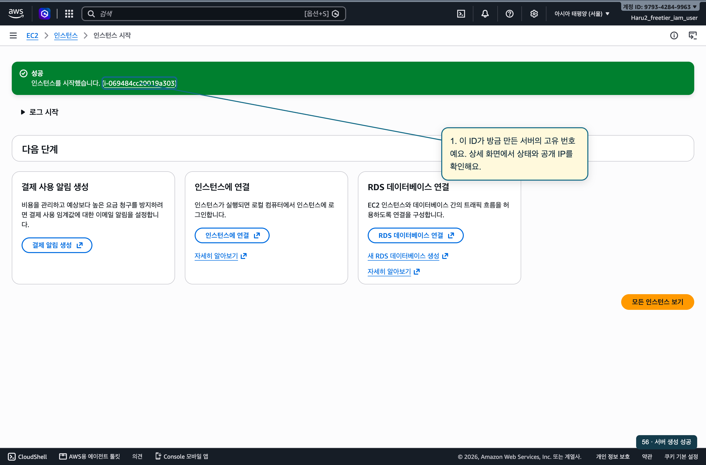

이 ID가 방금 만든 서버의 고유 번호예요. 상세 화면에서 상태와 공개 IP를 확인해요.

[말풍선 없는 원본](raw/56b-instance-created.png)

### 45 서버의 두 가지 주소

실행 상태와 공개·내부 주소를 확인한다. 이번 서버의 공개 IP는 43.201.62.16, 내부 IP는 10.77.1.121이다.


공개 IP는 인터넷에서 접속할 주소예요. 내부 IP는 VPC 안에서 쓰는 주소예요. 우리가 만든 서브넷 범위에 들어가요.

[말풍선 없는 원본](raw/57c-public-private-ip.png)

## SSH와 웹페이지 확인

### 46 내 컴퓨터에서 SSH로 접속

연결 → SSH 클라이언트 내부를 연다. 콘솔의 .pem 파일명은 예시다. 이번에는 기존 개인 키 ~/.ssh/codyssey-haru2-ed25519로 접속했다.

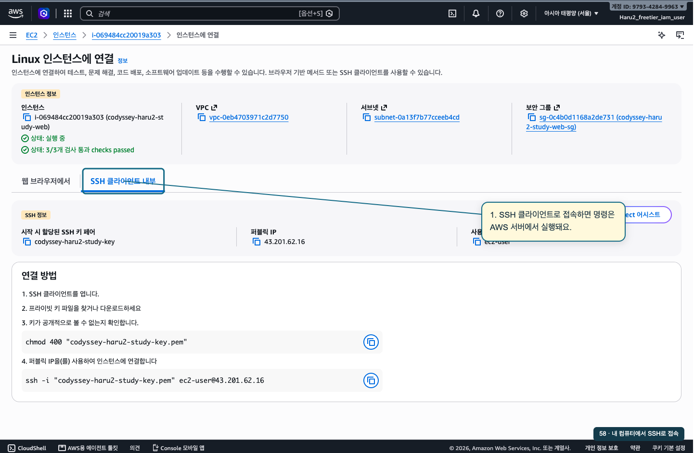

SSH 클라이언트로 접속하면 명령은 AWS 서버에서 실행돼요.

[말풍선 없는 원본](raw/58-ssh-instructions.png)

### 47 접속 위치가 바뀌면 SSH 허용 주소도 확인

이번 실습에서는 네트워크가 바뀌어 SSH가 시간 초과됐다. 현재 공인 IP와 허용된 /32 주소를 비교한다.

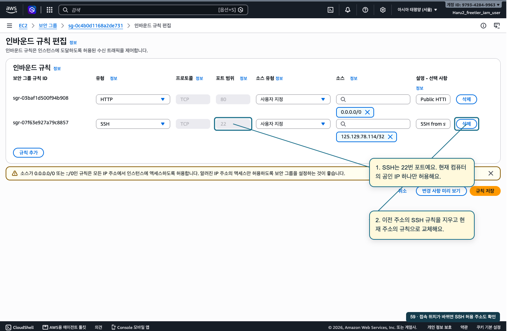

SSH는 22번 포트예요. 현재 컴퓨터의 공인 IP 하나만 허용해요. 이전 주소의 SSH 규칙을 지우고 현재 주소의 규칙으로 교체해요.

[말풍선 없는 원본](raw/59a-ssh-ip-changed.png)

### 48 현재 주소 하나로 SSH 접속 허용

기존 SSH 규칙을 지우고 현재 주소 218.51.90.68/32의 SSH 규칙을 추가해 저장했다. 각자의 현재 주소를 사용한다.

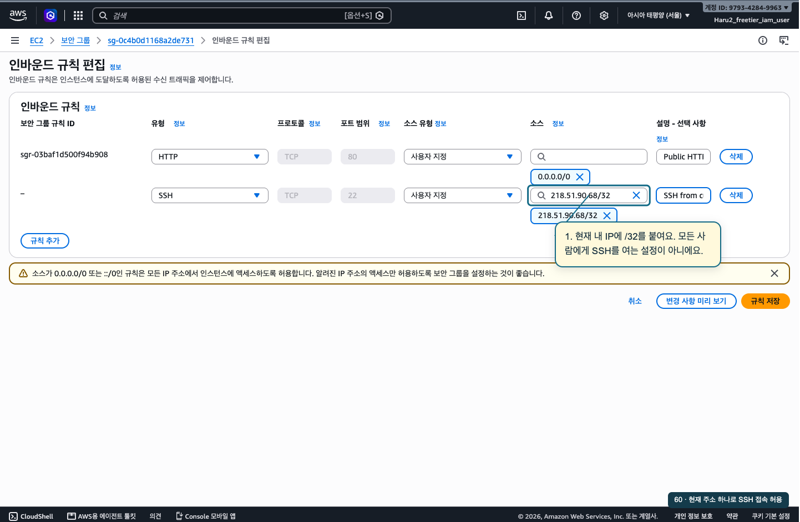

현재 내 IP에 /32를 붙여요. 모든 사람에게 SSH를 여는 설정이 아니에요.

[말풍선 없는 원본](raw/59b-ssh-current-ip.png)

### 49 현재 적용된 접속 규칙 확인

HTTP 80 전체 허용과 SSH 22 현재 주소 하나 허용을 다시 확인한다. 설정 확인 후 취소로 나오면 추가 변경은 없다.

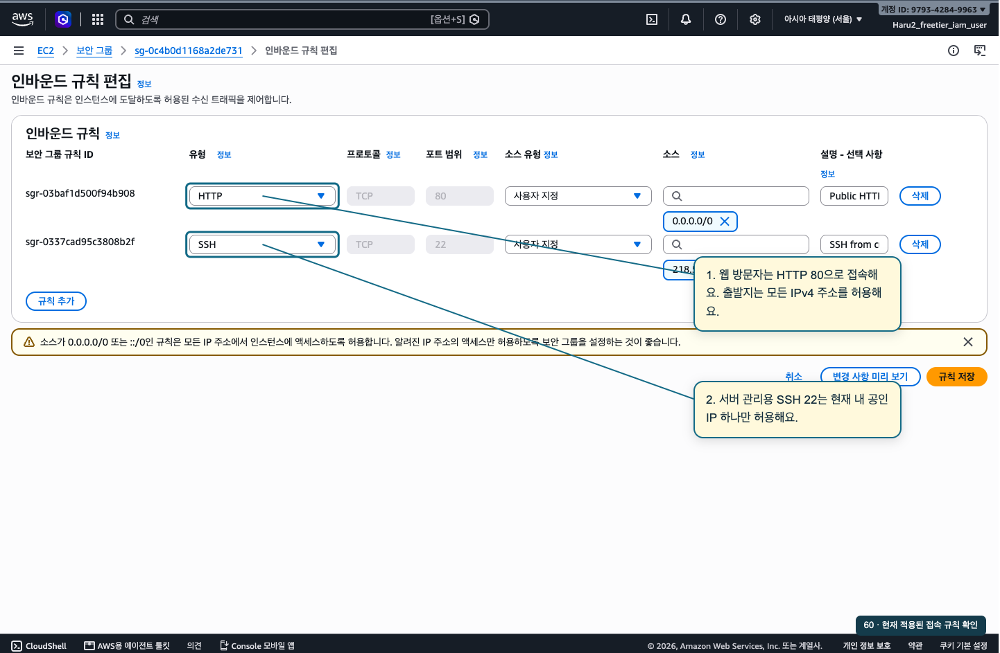

웹 방문자는 HTTP 80으로 접속해요. 출발지는 모든 IPv4 주소를 허용해요. 서버 관리용 SSH 22는 현재 내 공인 IP 하나만 허용해요.

[말풍선 없는 원본](raw/60-security-final.png)

### 50 실제 SSH 실행 결과 읽기

SSH에서 Nginx를 설치하고 site/index.html과 config/nginx.conf를 적용한다. 설정 검사·실행 상태·localhost/health 응답을 확인한다. 이 이미지는 실제 로그를 읽기 좋게 표시한 화면이다.


설정을 검사하고 Nginx를 실행했어요. localhost는 지금 명령을 실행하는 EC2 자신이에요. 설정 검사 성공, active, HTTP 200과 ok가 나오면 서버 내부에서는 정상이에요.

[말풍선 없는 원본](raw/61-ssh-server-check.png)

### 51 인터넷에서 웹페이지 접속 성공

내 브라우저에서 http://43.201.62.16/를 연다. 홈페이지와 정상 동작 표시를 확인한다.


브라우저가 서버의 /health에 요청을 보내고 HTTP 200을 받았어요. 이 화면의 파일은 AWS EC2 안에 있어요. Nginx가 인터넷으로 보내준 결과예요.

[말풍선 없는 원본](raw/62-external-home.png)

### 52 상태 확인 주소도 정상 응답

GET /health 링크를 누르고 ok 응답을 확인한다. 이번 실습은 HTTPS 인증서를 구성하지 않았으므로 http://를 사용한다.


ok는 Nginx 설정에서 만든 응답이에요. 서버 내부와 외부에서 같은 결과를 확인했어요.

[말풍선 없는 원본](raw/63-external-health.png)

## SSH에서 실제로 한 작업

콘솔은 공개 키를 등록하고, 접속에는 대응하는 로컬 개인 키를 사용한다. 아래는 이번 실습의 경로이며 개인 키 내용은 저장소에 넣지 않는다.

```sh
ssh -i ~/.ssh/codyssey-haru2-ed25519 ec2-user@43.201.62.16
sudo dnf install -y nginx
```

로컬 저장소에서 파일을 보낸다.

```sh
scp -i ~/.ssh/codyssey-haru2-ed25519 site/index.html config/nginx.conf ec2-user@43.201.62.16:/tmp/
```

다시 EC2에서 적용하고 검사한다.

```sh
sudo install -m 644 /tmp/index.html /usr/share/nginx/html/index.html
sudo install -m 644 /tmp/nginx.conf /etc/nginx/nginx.conf
sudo nginx -t
sudo systemctl enable --now nginx
sudo systemctl reload nginx
systemctl is-active nginx
curl -i http://localhost/health
```

[설치 원본 로그](ssh-install.log) · [배포 원본 로그](ssh-deploy.log) · [외부 홈페이지 응답 헤더](external-home-headers.txt) · [외부 health 응답](external-health.txt)

## 19일 스터디와 정리

핵심 13장은 45분 설명용, 전체 52장은 다시 따라하기용이다. 중간 질문이 많으면 HTTP 규칙 차단 실험 대신 이번에 실제로 겪은 SSH 주소 변경 사례를 이야기한다. HTTP 규칙 제거·복구 실험은 이번 촬영에서는 실행하지 않았다.

이번 서버는 19일까지 계속 실행한다. 콘솔을 닫아도 서버는 꺼지지 않으며, 무료 적용 여부는 계정 혜택과 사용량에 따라 달라진다. 스터디 후 정리할 때는 새 자원 ID를 사용한다. [이번 자원 목록](resources.json), [첫 실습의 정리 절차](../../cleanup-checklist.md)를 참고한다. 첫 실습 자원은 이미 삭제됐으므로 예전 ID를 사용하지 않는다.

원본 캡처는 raw 폴더에 보존했다. explained 폴더는 실제 화면에 브라우저 설명 레이어를 얹어 촬영한 52장이다. SSH 확인 이미지는 실제 실행 로그를 표시한 읽기용 화면이며 AWS 콘솔 화면이 아니다. 로그인·비밀번호·인증 코드·개인 키 내용은 자료에 포함하지 않았다.
