# AWS에 웹서버 한 대 만들기 스터디 노트

2026년 10월 19일 · 클라우드를 처음 접하는 사람들과 함께 보는 45분 스터디

AWS에서 컴퓨터 한 대를 빌려 웹페이지를 띄워보자. 화면을 보면서 **서버가 어디에 있고, 인터넷에서 어떻게 찾아오며, 어떤 접속을 허용하는지** 함께 알아보는 시간이다. 중간에 궁금한 게 생기면 바로 멈추고 이야기해도 좋다.

오늘의 흐름은 **완성 화면 → 네트워크 → 서버 → 접속 확인 → 정리**다.

## 1 웹페이지부터 열어보기

**0~3분 · 함께 볼 것: 외부 브라우저의 웹페이지**

“지금 이 페이지 파일은 내 노트북에 있을까, AWS에 있는 컴퓨터에 있을까?”

브라우저는 주소로 요청을 보내고, 서버는 페이지 내용을 돌려준다. 이번에는 그 서버를 AWS에 만든다. AWS 서버가 계속 실행 중이면 내 노트북을 꺼도 다른 사람이 페이지를 볼 수 있다.

[10월 17일 실제 외부 접속 화면](https://github.com/develsvai/Codyssey_B3-1/blob/3e2133fc654b658ca723356dec53f389a44261cd/docs/evidence/external-homepage.png)

첫 실습 서버는 정리했고, 10월 17일 콘솔에서 같은 구성을 다시 만들었다. **19일 시연 주소는 [http://43.201.62.16/](http://43.201.62.16/)**다. 사용자 선택에 따라 19일까지 실행하며, 자동 종료는 설정하지 않았다.

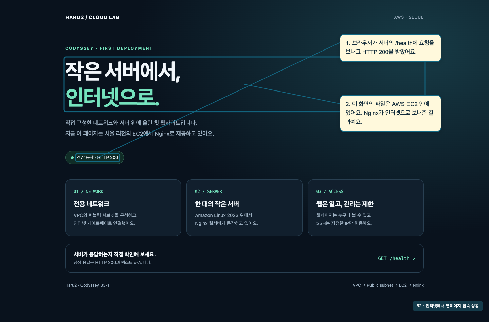

[전체 52장 따라하기](rebuild-20261017/index.html) · [온라인 따라하기](https://chatgpt.com/space/page_7d4e669d7c288191a35b2103480deed2)

## 2 오늘 만들 구조 살펴보기

**3~7분 · 함께 볼 것: 아래 구성도**

클라우드는 필요한 컴퓨터와 네트워크 같은 자원을 인터넷으로 빌려 쓰는 방식이다. AWS 콘솔은 그 자원을 만들고 관리하는 화면이다.

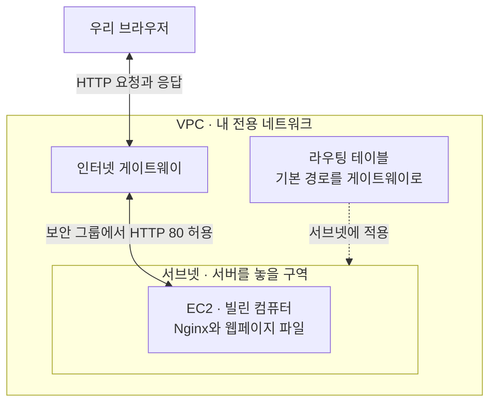

실선은 웹 요청과 응답의 흐름이다. 점선은 설정이 적용되는 관계다. 라우팅 테이블은 목적지에 따라 보낼 곳을 정하는 규칙이고, 보안 그룹은 EC2에 적용하는 통신 허용 규칙이다.

지금은 이름을 외우기보다 “공간을 만들고, 인터넷 길을 연결하고, 컴퓨터를 놓는다” 정도로 읽으면 된다.

## 3 누가 어디에 만들지 확인하기

**7~10분 · 함께 볼 것: 로그인 사용자와 서울 리전**

**IAM**은 AWS에서 누가 어떤 작업을 할 수 있는지 정한다. 로그인에 성공해도 서버를 만들 권한이 없으면 생성은 거절된다. 이번에는 실습에 필요한 권한이 연결된 IAM 사용자를 쓴다.

**리전**은 자원을 만들 지역이다. 이번 실습은 서울 `ap-northeast-2`에서 한다. **가용 영역(AZ)**은 한 리전 안에 있는 분리된 인프라 구역이며, 서브넷은 하나의 AZ에 속한다.

**같이 확인:** 콘솔의 로그인 사용자와 선택한 리전이 맞는지 찾아보자.

[더 궁금하면 AWS IAM 설명](https://docs.aws.amazon.com/AWSEC2/latest/UserGuide/security-iam.html)

## 4 VPC와 서브넷 만들기

**10~16분 · 함께 볼 것: VPC 생성 화면과 서브넷 생성 화면**

VPC는 내 AWS 자원을 배치할 전용 네트워크다. 서브넷은 그 네트워크 안의 주소 범위를 나눈 구역이다.

| 항목 | 이번 실습의 값 | 이렇게 이해하기 |
|---|---|---|
| VPC 주소 범위 | `10.77.0.0/16` | 내부에서 사용할 큰 주소 범위 |
| 서브넷 주소 범위 | `10.77.1.0/24` | 위 범위에 포함되는 작은 주소 범위 |
| 서브넷의 AZ | `ap-northeast-2a` | 서버를 배치할 가용 영역 |

`/16`, `/24`는 주소 범위의 크기를 나타내는 표기다. 오늘은 계산보다 “작은 범위가 큰 범위 안에 들어간다”는 관계만 잡자.

**같이 해보기:** VPC를 만든 뒤, 서브넷 생성 화면에서 방금 만든 VPC를 선택한다. 이름과 소유자를 구분하는 태그도 함께 넣는다.

**짚어볼 것:** 서브넷 이름에 `public`을 붙이는 것만으로 인터넷에 연결되지는 않는다.

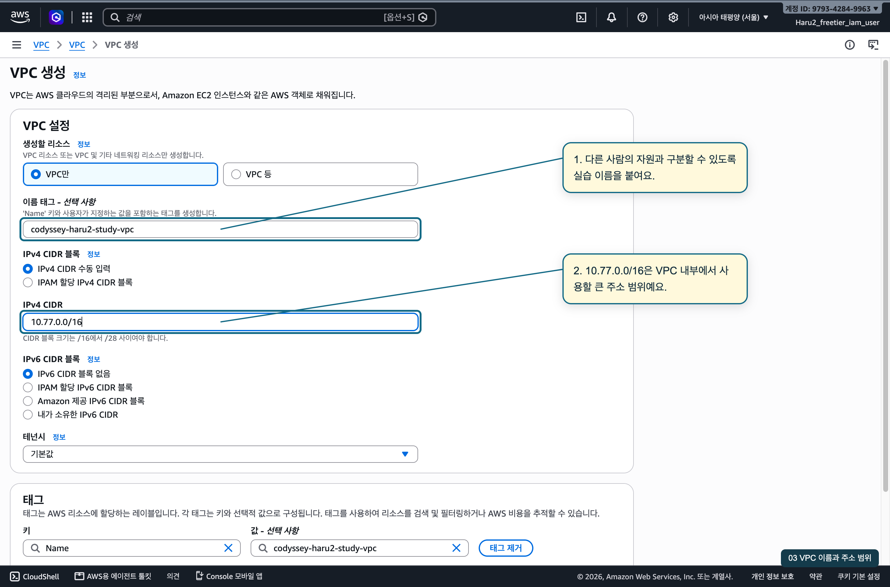

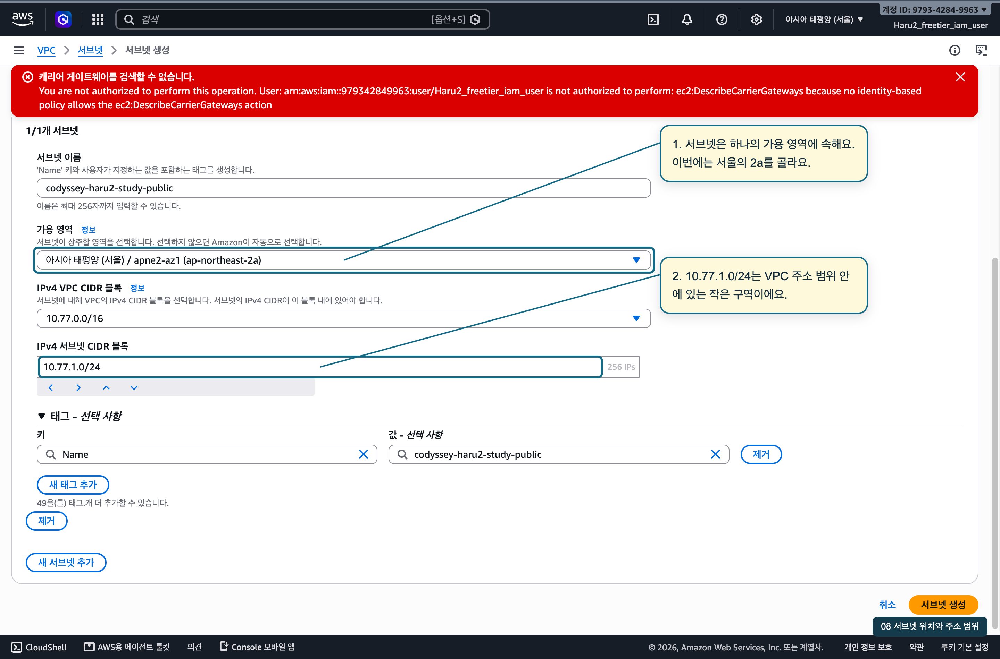

## 5 인터넷으로 통하는 길 연결하기

**16~22분 · 함께 볼 것: 게이트웨이 연결과 라우팅 테이블의 두 탭**

인터넷 게이트웨이는 VPC와 인터넷을 연결하는 구성 요소다. 만들어서 VPC에 연결하고, 서브넷이 사용할 라우팅 테이블에 경로를 추가한다.

| 목적지 | 보낼 곳 | 의미 |
|---|---|---|
| `10.77.0.0/16` | `local` | VPC 내부 주소로 가는 경로 |
| `0.0.0.0/0` | 이번 인터넷 게이트웨이 | 더 구체적인 경로가 없는 IPv4 목적지에 쓰는 기본 경로 |

**같이 해보기:** ① 게이트웨이를 VPC에 연결한다. ② 기본 경로를 추가한다. ③ 그 라우팅 테이블을 이번 서브넷과 연결한다.

이렇게 인터넷 게이트웨이로 향하는 경로가 있는 서브넷을 퍼블릭 서브넷이라고 부른다. 이번 방식으로 EC2와 인터넷이 IPv4 통신을 하려면 EC2의 공인 IP도 필요하다.

**확인 질문:** 경로를 만들어놓고 다른 서브넷에 연결했다면, 우리가 만든 서버에 적용될까?

[인터넷 연결 조건](https://docs.aws.amazon.com/vpc/latest/userguide/VPC_Internet_Gateway.html) · [라우팅 테이블 설명](https://docs.aws.amazon.com/vpc/latest/userguide/subnet-route-tables.html)

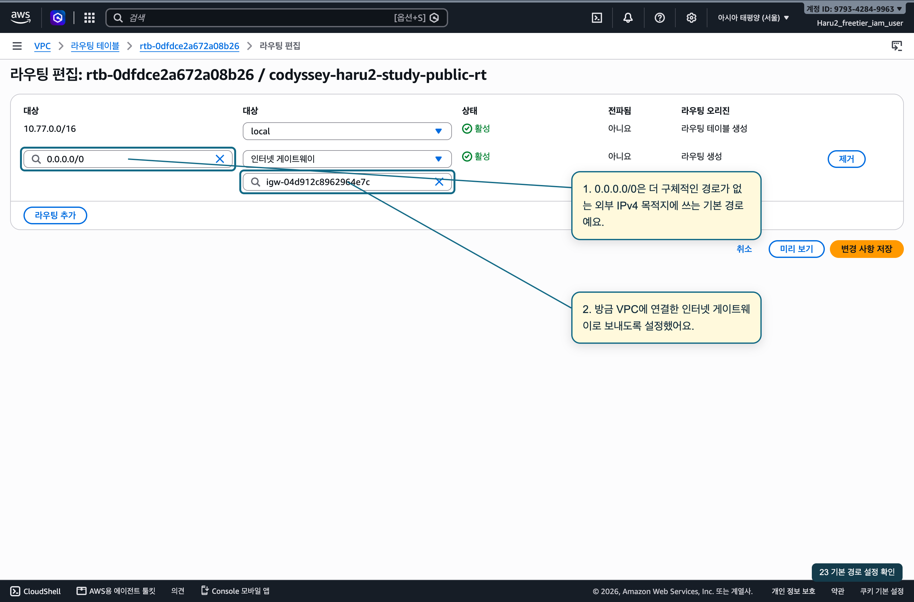

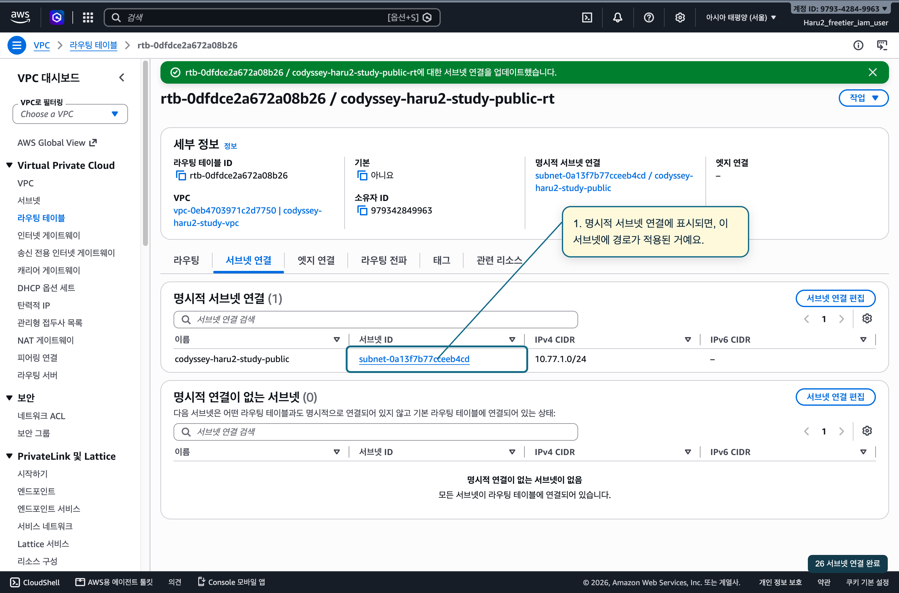

## 6 웹 접속과 관리 접속 구분하기

**22~26분 · 함께 볼 것: 보안 그룹의 인바운드 규칙**

보안 그룹은 서버로 들어오고 나가는 통신을 제어한다. **포트**는 컴퓨터 안에서 어떤 서비스와 통신할지 구분하는 번호다. 이번에는 두 가지만 설정한다.

| 용도 | 포트 | 허용할 출발지 |
|---|---|---|
| HTTP 웹페이지 보기 | TCP 80 | `0.0.0.0/0` — 모든 IPv4 주소 |
| SSH 서버 관리하기 | TCP 22 | 현재 내 공인 IP의 `/32` — 주소 하나 |

라우팅 테이블의 `0.0.0.0/0`는 보낼 경로를 고르는 데 쓰이고, 여기서는 들어오는 통신의 출발지 범위를 정한다.

**같이 생각하기:** 모두가 웹페이지를 볼 수 있게 하면서, 관리 접속은 내 컴퓨터에서만 가능하게 하려면 어떻게 해야 할까?

IAM은 AWS 자원에 대한 작업 권한, 보안 그룹은 네트워크 통신 허용, SSH 키는 서버 로그인에 쓰는 인증 수단이다.

[보안 그룹 설명](https://docs.aws.amazon.com/AWSEC2/latest/UserGuide/ec2-security-groups.html)

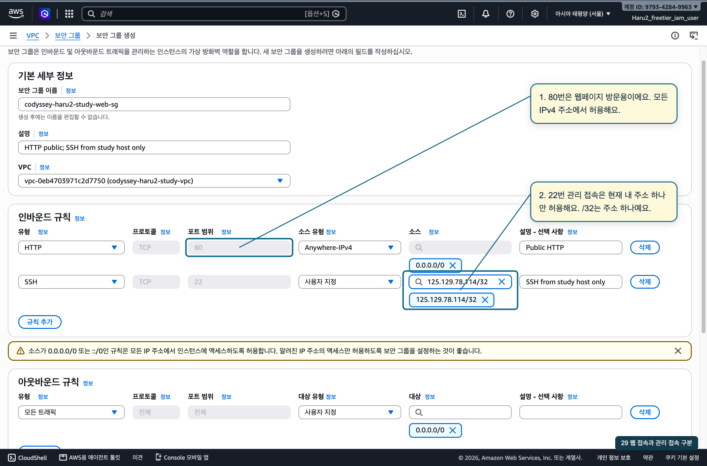

## 7 EC2 컴퓨터 한 대 만들기

**26~32분 · 함께 볼 것: EC2 생성 화면의 주요 입력 항목**

EC2 인스턴스는 AWS에서 실행하는 가상 컴퓨터다. 컴퓨터를 준비할 때처럼 운영체제, 사양, 디스크를 정한다.

| 항목 | 이번 실습 | 한 줄 설명 |
|---|---|---|
| AMI | Amazon Linux 2023 | 운영체제 등이 들어 있는 시작 틀 |
| 인스턴스 유형 | `t3.micro` | CPU와 메모리 등의 사양 |
| EBS | `gp3` 8 GiB | 운영체제와 페이지 파일을 저장할 디스크 |
| 키페어 | 실습용 공개키 등록 | 내 개인키로 SSH 로그인할 때 사용 |
| 네트워크 | 방금 만든 VPC와 서브넷 | 컴퓨터를 놓을 위치 |
| 공인 IPv4 | 자동 할당 | 인터넷에서 이번 서버에 접속할 주소 |
| 보안 그룹 | 방금 만든 그룹 | 웹 접속과 관리 접속 규칙 |

내부 IP는 VPC 안에서 쓰는 주소, 공인 IP는 이번 실습에서 인터넷 접속에 쓰는 주소다.

**같이 확인:** 생성 후 실행 상태, 선택한 VPC·서브넷, 공인 IP를 찾아보자. `running`은 컴퓨터가 실행 중이라는 뜻이다. 웹페이지 제공 여부는 다음 단계에서 확인한다.

[EC2 구성 요소 설명](https://docs.aws.amazon.com/AWSEC2/latest/UserGuide/EC2_GetStarted.html)

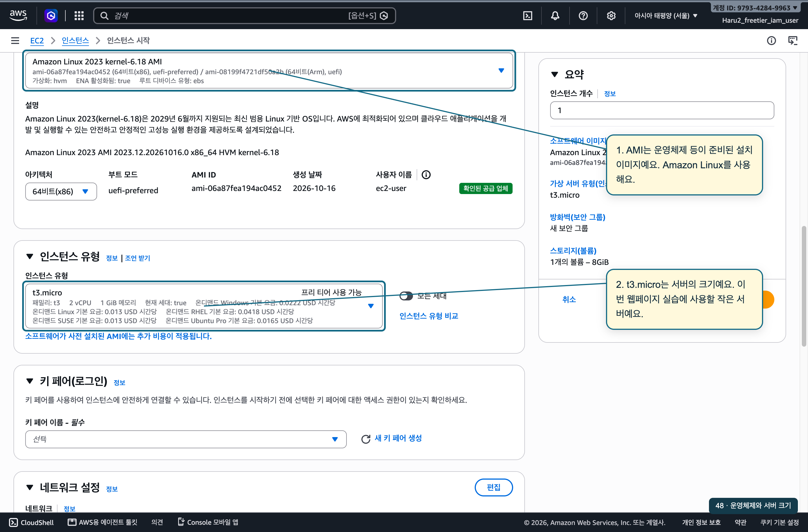

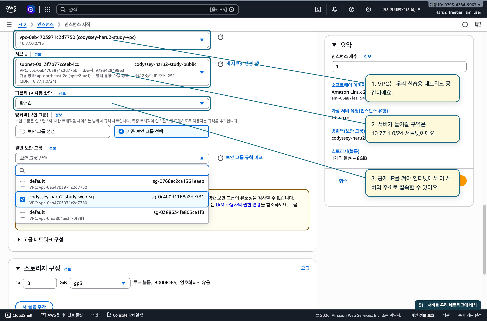

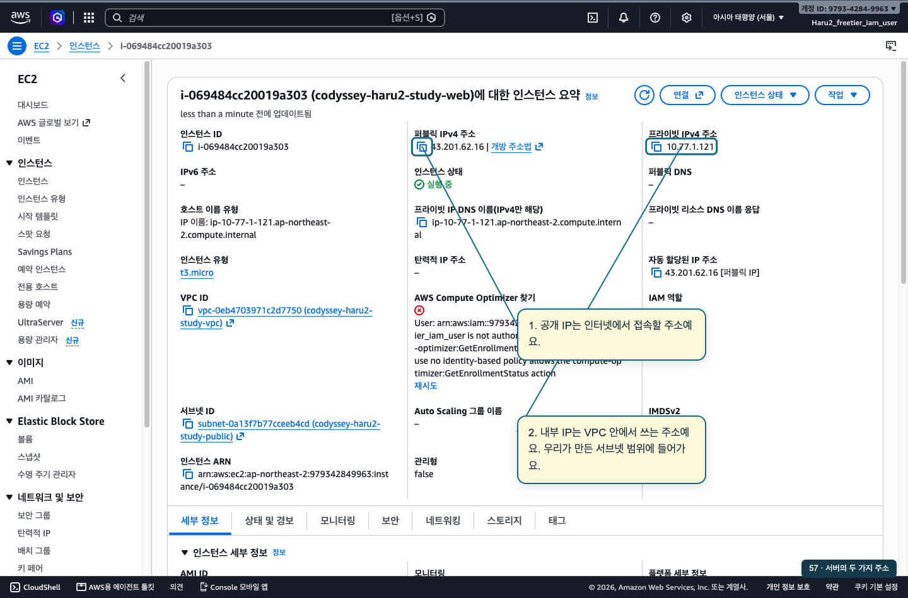

## 8 서버에 웹페이지 올리기

**32~37분 · 함께 볼 것: SSH 터미널과 웹서버 확인 결과**

SSH로 접속하면 명령을 실행하는 곳은 AWS의 컴퓨터다. **Nginx**는 브라우저의 웹 요청을 받고 페이지를 돌려주는 프로그램이다.

함께 볼 작업은 세 가지다.

1. SSH 키를 사용해 EC2에 접속한다.
2. Nginx를 설치하고 기존 과제의 페이지 파일과 설정 파일을 적용한다.
3. 설정을 검사한 뒤 실행하고, 서버 안에서 먼저 응답을 확인한다.

설정과 페이지를 적용한 뒤 다음을 확인한다.

```sh
sudo nginx -t
sudo systemctl enable --now nginx
sudo systemctl reload nginx
curl -i http://localhost/health
```

`localhost`는 명령을 실행 중인 컴퓨터 자신을 가리킨다. 여기서는 EC2 자신이다. `/health`는 이번 과제 설정에서 만든 상태 확인 주소이며, Nginx의 기본 기능으로 자동 생성되는 주소는 아니다.

**기대 결과:** 설정 검사 성공, HTTP `200`, 응답 내용 `ok`.

[웹페이지 파일](https://github.com/develsvai/Codyssey_B3-1/blob/3e2133fc654b658ca723356dec53f389a44261cd/site/index.html) · [적용할 Nginx 설정](https://github.com/develsvai/Codyssey_B3-1/blob/3e2133fc654b658ca723356dec53f389a44261cd/config/nginx.conf)

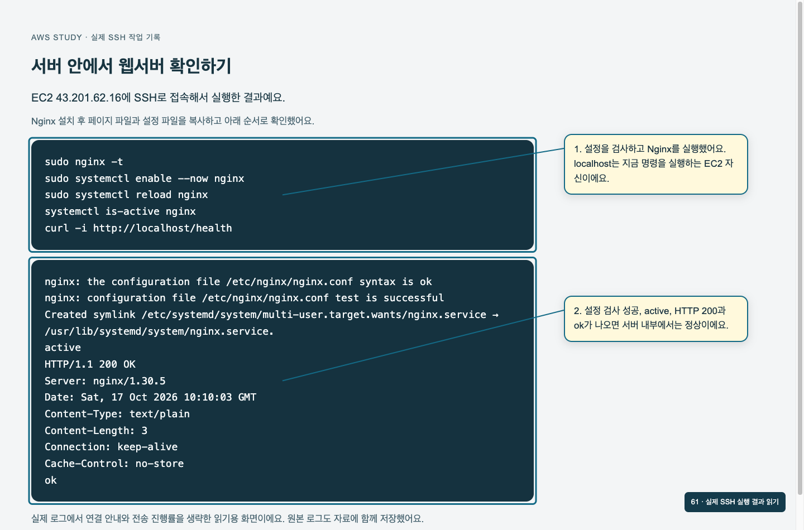

## 9 다른 컴퓨터에서 접속해보기

**37~42분 · 함께 볼 것: 외부 브라우저와 보안 그룹**

내 브라우저에서 [웹페이지](http://43.201.62.16/)와 [상태 확인 주소](http://43.201.62.16/health)를 연다. 다른 계정에서 따라 만들 때는 본인의 새 공인 IP를 사용한다.

페이지가 열리면 브라우저의 요청이 인터넷을 통해 서버에 도착하고, Nginx의 응답이 돌아온 것이다. HTTP `200`은 이 요청이 성공했다는 응답 코드다.

시간이 되면 내 실습 서버에서 짧게 비교해보자.

1. 정상 접속을 확인한다.
2. 보안 그룹에서 HTTP 80 허용 규칙만 잠시 제거한다.
3. 새 브라우저 연결로 접속이 실패하는지 확인한다.
4. 규칙을 복구하고 다시 새 연결로 성공을 확인한다.

기존 연결이나 캐시 화면이 남을 수 있으므로, 이미 열어둔 화면의 새로고침만으로 판단하지 않는다. 이번 촬영에서는 HTTP 차단 실험을 하지 않았다. 시간이 부족하면 실제 SSH 주소 변경 사례로 대체한다.

**확인 질문:** 서버가 실행 중인데 페이지가 안 열린다면 어디부터 살펴볼까?

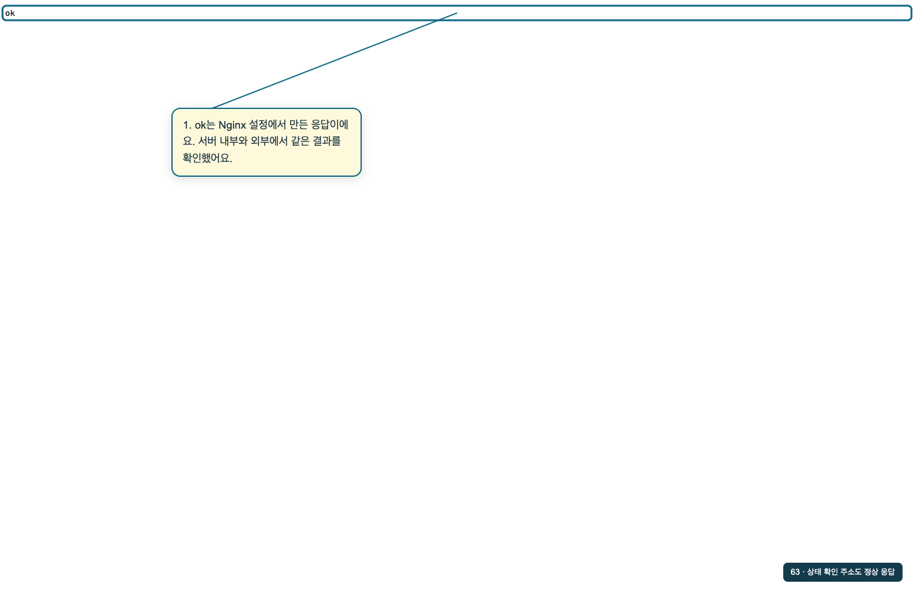

## 10 다 썼으면 정리하기

**42~45분 · 함께 볼 것: 중지와 종료의 차이, 스터디 후 정리 절차**

이번 서버는 19일까지 유지하므로 오늘 삭제 화면을 실행하지 않았다. 아래는 사용을 마친 뒤 적용할 정리 순서다.

AWS 콘솔 탭을 닫아도 서버는 계속 실행된다. 중지하면 나중에 다시 켤 수 있지만 디스크는 남고, 디스크 비용은 계속 발생할 수 있다. 종료는 해당 인스턴스를 없애는 작업이다. [인스턴스 상태와 과금 설명](https://docs.aws.amazon.com/AWSEC2/latest/UserGuide/ec2-instance-lifecycle.html)

접속 화면을 저장한 다음, 실습 자원을 연결의 반대 순서로 정리한다. EC2 종료와 디스크·네트워크 인터페이스 제거를 확인하고, 보안 그룹·서브넷·별도 라우팅 테이블·게이트웨이·VPC·실습 키페어를 정리한다. 게이트웨이는 VPC에서 분리한 뒤 삭제한다.

**마지막으로 서로 설명해보기**

- 웹페이지 방문자도 내 AWS IAM 계정이 필요할까?
- 서버를 만들 권한이 있으면 HTTP 접속도 자동으로 열릴까?
- 콘솔 창을 닫으면 서버도 꺼질까?

[첫 실습에서 사용한 정리 체크리스트](https://github.com/develsvai/Codyssey_B3-1/blob/3e2133fc654b658ca723356dec53f389a44261cd/docs/cleanup-checklist.md)

## 진행할 때 참고할 메모

처음 45분은 위 순서로 보되, 질문이 많으면 실제 SSH 접속 장애와 주소 수정 캡처로 바꾸고 대화에 시간을 쓰자. 구성도를 중간중간 다시 보여주면서 “방금 추가한 게 어디인지”만 짚어줘도 흐름을 잡기 쉽다.

질문의 답은 다음 정도면 충분하다.

- 라우팅 테이블은 연결된 서브넷에 적용된다. 이번 서브넷이 실제로 어떤 테이블을 쓰는지 확인한다.
- 접속 실패 시 새 공인 IP, HTTP 80 규칙, 인터넷 경로와 서브넷 연결, Nginx 실행 및 서버 내부 응답을 차례로 확인한다.
- 공개한 정적 웹페이지의 방문자는 AWS IAM 계정이 필요하지 않다. 자원 관리 권한과 웹 접속 허용은 서로 다른 설정이다.
- 콘솔 창을 닫아도 서버는 계속 실행된다.

**캡처를 넣을 때:** 화면 하나에 설명 2~3개만 붙인다. 클릭 위치, 입력값의 의미, 성공했을 때 보이는 결과를 구분한다. 전체 조작 순서는 별도의 촬영 메모에 기록한다.

VPC부터 외부 접속까지 실제 설명 캡처 52장을 [전체 따라하기](rebuild-20261017/walkthrough.md)에 넣었다. 원본 이미지와 SSH·HTTP 확인 로그도 함께 저장했다. SSH 연결 안내의 .pem 이름은 예시이며 이번 실습은 기존 ED25519 개인 키를 사용했다. SSH 허용 주소는 네트워크 변경으로 125.129.78.114/32에서 218.51.90.68/32로 교체했다. 19일 장소에서도 현재 주소를 다시 확인한다.
